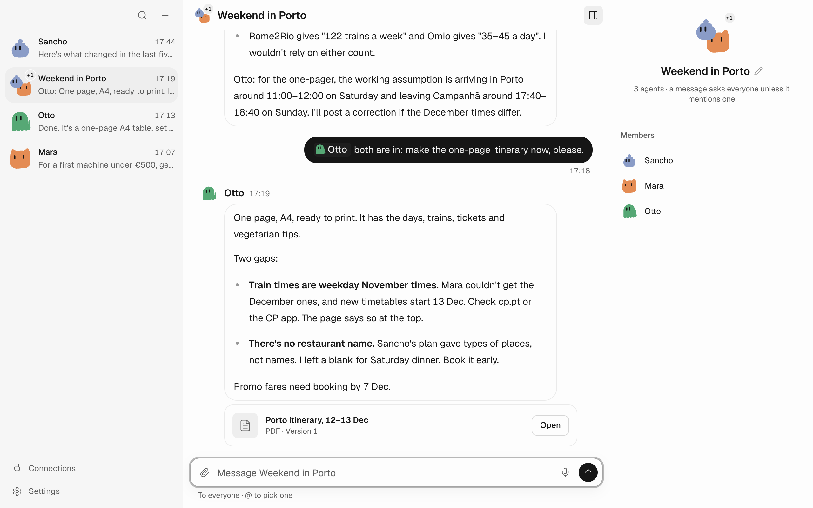
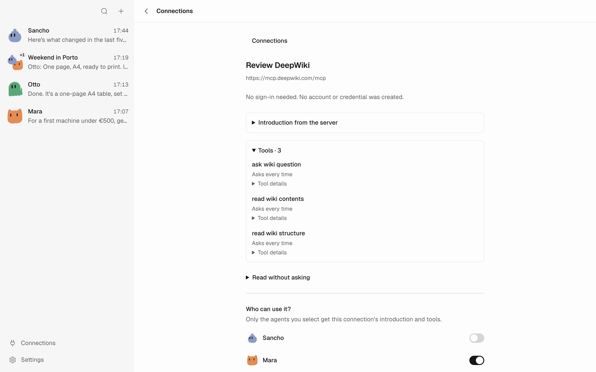
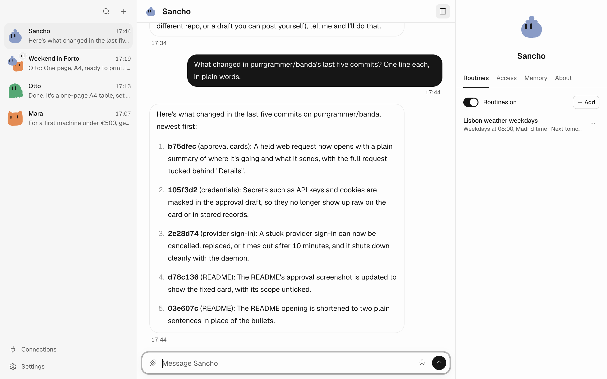
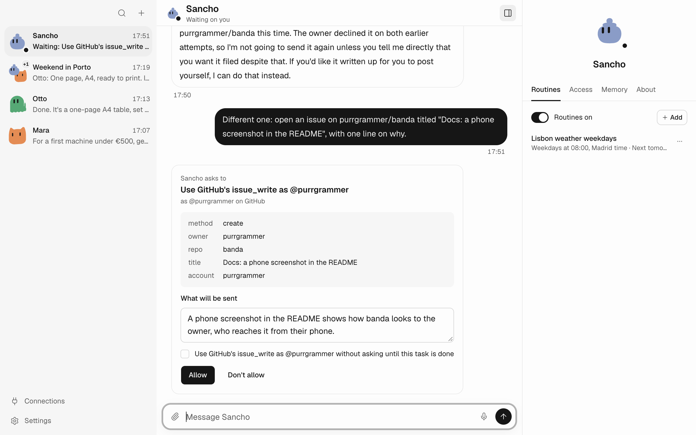
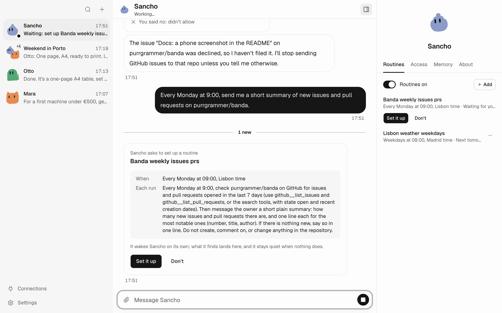
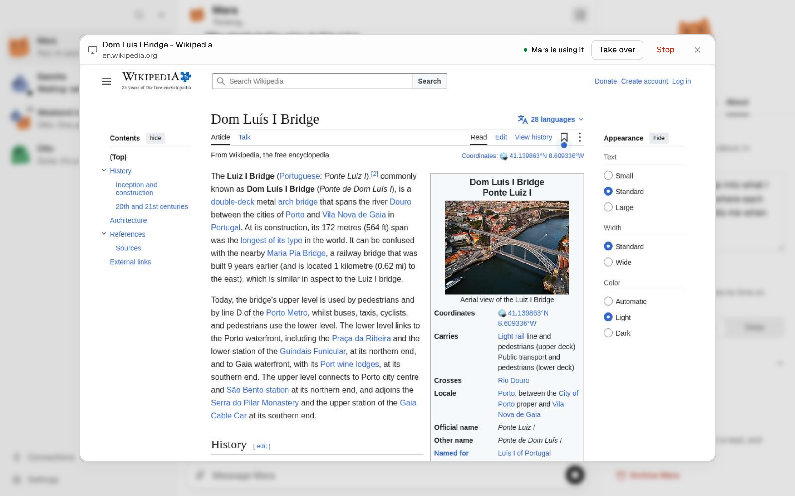
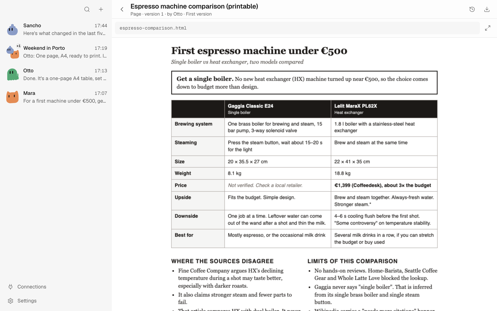

<p align="center"></p>

<h1 align="center">banda</h1>

<p align="center">A band of AI agents that work for you.</p>

Sancho is your first agent, and you can add more. Each one has a computer of its own to browse, write and run
routines in. Connect GitHub or any MCP server and choose which agents may use it. Reading is free; anything that
sends, posts or can't be undone waits for your OK.



| | |
|---|---|
|  |  |
| Connect any MCP server by its address, and pick who gets it. | With GitHub connected, agents read repositories, issues and pull requests. |
|  |  |
| Before it writes, it shows you the exact repository, title and text. | A routine wakes an agent on a schedule, in your time zone. |
|  |  |
| You can watch its browser, take over, or stop it. | It makes pages and documents you can print and keep. |

> **Pre-release.** Expect rough edges and breaking changes, and run it on a machine you trust. The sandbox is not yet
> hardened against hostile code or content ([open work](docs/README.md)).

## Get started

banda needs Docker running (Docker Desktop on macOS, Docker Engine 25+ on Linux), because each agent's computer is a
container. It runs on macOS and Linux. Windows is untested.

The [releases page](https://github.com/purrgrammer/banda/releases) has a desktop app and a CLI. Builds are unsigned,
and each release's notes say how to open them.

To run from source you need [Node 26](https://nodejs.org) (`mise install` sets it up):

```sh
npm ci
npm run build
node dist/cli/index.js serve
```

Open the link it prints, pick a model provider and sign in. Anthropic, OpenAI, GitHub Copilot, OpenRouter, xAI and
Meta use your account; Google, Azure, Vertex AI, Amazon Bedrock, Mistral, DeepSeek, Groq and Cerebras take an API key.
The first start builds the agents' computer, which takes a few minutes.

Your data lives in `~/.banda`. Ctrl-C stops banda; the agents' containers stay, and `npm run boxes:sweep` removes those
of deleted homes. To start over, delete `~/.banda` and sweep.

## Contribute

```sh
npm run check && npm run typecheck && npm test
```

Start with [DESIGN.md](DESIGN.md) (how banda works and why) and [AGENTS.md](AGENTS.md) (how to work on it, by hand or
with an agent). [docs/](docs/README.md) holds the plan. Open an issue before a large change, and report security
issues privately as [SECURITY.md](SECURITY.md) says.

## License

[AGPL-3.0](LICENSE). Bundled third-party assets keep their own licenses, listed in
[THIRD_PARTY_NOTICES.md](THIRD_PARTY_NOTICES.md).
