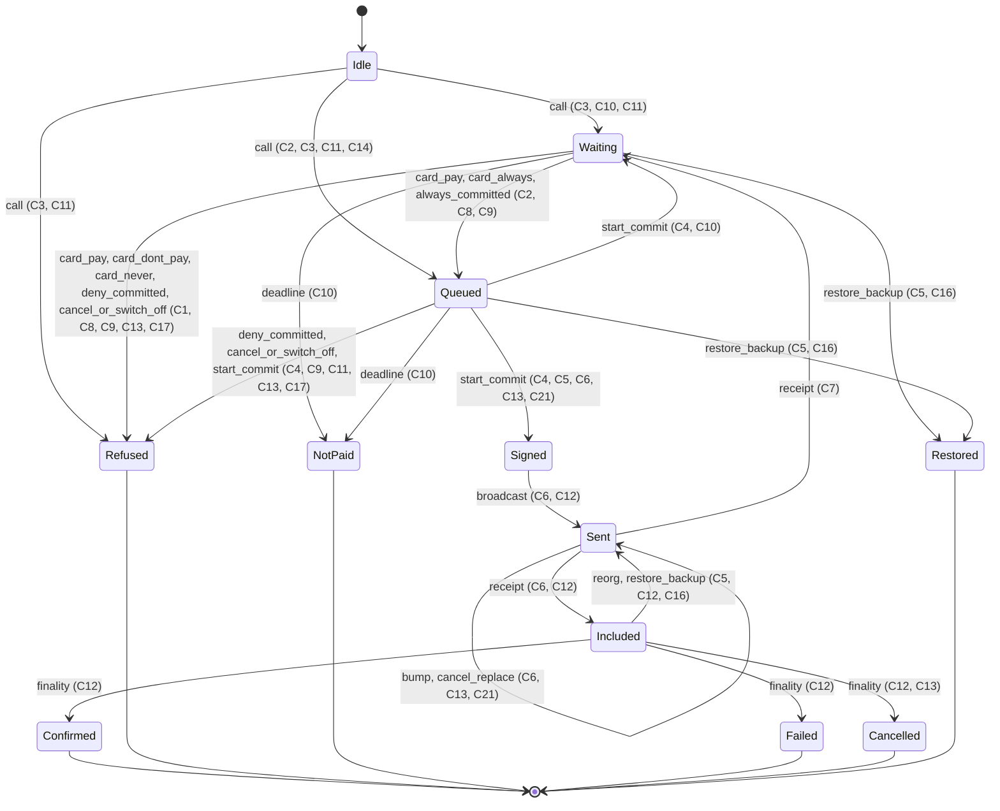

# Wallet concurrency rules: how the scenarios are kept from conflicting

Status: analysis for the RFC in [`../wallets.md`](../wallets.md), dated 2026-11-23. Nothing here is a DESIGN.md rule
yet (principle 6). The cases are in [`hazards.md`](hazards.md) (H-ids); each case's `Rules:` field names the rules
below, and the "Resolves" line under each rule is generated from those fields, so the two files cannot drift apart.

## 1. Why the outcome can be deterministic

Two scenarios conflict when the same events, in a different order or with a crash between them, could end in two
different outcomes (paid once or twice, refused or paid, one key or another). banda removes that freedom with one
fact and one discipline.

**The fact.** One process owns a home's store (pi-durable's lock), and the store commits on one line: each commit
reads what it depends on and writes its result atomically. Every decision that matters (admit, answer, refuse, take a
nonce, record an outcome) is made inside one commit. So any two acts are ordered by their commits, and the later one
always sees the earlier one's result. No rule depends on which thread runs first.

**Readings are inputs.** Some rules read a clock or the chain: C10's approval age and the 24 h deadlines, C19's skew,
C3 step 5's `eth_getCode`, step 6's keychain answer, step 8's balance at block b. Each such reading enters a decision
only as a commit input: a timer firing is a committed event, the `now` C10 and C19 use is written into the commit, and
a balance or code reading is stored with its block number and read back from the store (C22). So the outcome is a
function of (inputs, store, recorded readings), and the C3 property test generates the readings with the inputs.

**The discipline.** An effect outside the store (the keychain, the signer, the RPC, the proxy's 402, a box's retry)
happens only between two commits: one before it that makes it safe to repeat, and one after it that records what it
did. A crash anywhere leaves the store in a state from which the next start redoes the effect safely or knows it was
done. Everything not in the store (balances, incoming rows, the chain's view) is evidence read at a block, never an
order.

The actors whose acts interleave: the **owner** (card answers, rule and wallet changes, Send, cancel, reveal, restore,
from any paired device), each **agent's tool calls** (several chats, a group's turns, routines), the wallet's **lane**
(a durable task), the **outside** (the chain's blocks and reorgs, the RPC, a foreign spend with the exported key, the
keychain, the facilitator), and the **system** (crash, power loss, restart, upgrade, backup, restore, fork).

## 2. The rules

### C1 · One commit line

Every decision is one commit that reads its inputs inside the transaction. Two acts on the same thing are ordered by
commit; the second sees the first and answers accordingly ("already answered on your phone", "Ana is denied now",
"already sent"). Mechanism: pi-durable's single writer per storage. Proven by: fault tests that interleave each pair
of section 4 at a commit boundary.

Resolves (5 cases, 2 critical): H-047, H-049, H-086, H-118, H-279.

### C2 · One lane per wallet, FIFO

Each wallet has exactly one lane: a durable task whose id derives from the wallet id, started in a commit only if
absent. Payments (agents' and the owner's) enter it in queue-commit order and leave in that order. Owner acts on a
payment already in the lane (a cancel replacement, a raised fee ceiling) enter the lane as commands, so the lane is
the only writer of a wallet's nonces and versions. Proven by: a fault test that starts a lane twice; the nonce spike
(127 of 127 crash runs paid once; viem's in-memory nonce manager failed 10 of 20 runs with two processes).

Resolves (9 cases, 3 critical): H-040, H-049, H-112, H-132, H-149, H-164, H-199, H-252, H-254.

### C3 · Fixed admission order

A tool call is admitted by checks in this order; the first that fails answers, so the same inputs always give the same
answer:

1. the wallet exists and is not archived or being removed;
2. the agent is on for that wallet (resolved only among the agent's own wallets);
3. the wallet connection's tool is on;
4. the arguments parse (decimal string in the token's units, a listed token, positive, within its decimals);
5. the recipient's canonical identity: EIP-55 on the wallet's network; not the zero address, the token, the wallet
   itself or a precompile; contract and look-alike flags for the card;
6. the wallet can sign now: lease held, keychain usable, not host mode and no coding agent connected (TA-1, H-065),
   chain id matches, the address has no code, the lane not blocked, parked or frozen;
7. the rule: **Deny** (wallet, recipient) > **Always** (wallet, agent, identity) > **Ask** > the wallet's default for
   unknown recipients (Ask; Deny only as the owner's opt-in, OD-13);
8. the available balance after reservations, fees included (C11);
9. dedup: one open ask per (wallet, agent, recipient, amount, asset); a duplicate is answered with the open card.
   There is no count of asks and no burst check: the balance is the only cap (requirement 2), and no burst pause is
   built, not even as an opt-in (OD-12).

Proven by: a property test over generated calls, states and recorded readings that checks the answer is a function of
(inputs, store, readings); PaymentLane's `AccessAtStart`, `DenyAtStart` and `AlwaysNeverAsks` (model/README.md).

Resolves (37 cases, 5 critical): H-051, H-053, H-054, H-056, H-057, H-058, H-059, H-060, H-064, H-066, H-071, H-074,
H-075, H-076, H-082, H-091, H-093, H-094, H-096, H-098, H-100, H-102, H-103, H-106, H-137, H-138, H-148, H-149, H-157,
H-158, H-200, H-206, H-243, H-255, H-256, H-277, H-317.

### C4 · The fused start commit is the burn point

When the lane reaches a payment: the signer reads and proves the key and signs in its own memory; then **one commit**
re-checks the payment (still Queued, not refused by a cancel or a Deny's sweep), C3 steps 1, 2, 6, 7 and 8, and the
approval's freshness (C10); takes nonce = ledger by compare-and-set; appends the signed version; syncs (C21); and moves the payment to Signed. Before
this commit a refusal costs nothing and the bytes are dropped; after it the nonce is burnt and the payment is the
lane's to finish (C13). Proven by: the nonce spike; the lane model (section 5) with this re-check off produced "signed
after a Deny committed", and its first run, which re-checked only the rule, produced "refused but paid".

Resolves (29 cases, 7 critical): H-021, H-026, H-027, H-033, H-042, H-047, H-054, H-074, H-081, H-082, H-084, H-085,
H-086, H-087, H-088, H-112, H-113, H-116, H-117, H-118, H-126, H-128, H-130, H-131, H-133, H-143, H-165, H-252, H-257.

### C5 · The nonce ledger

Per wallet, in the store. Never lowered. Raised to the chain's count only at `finalized`, or when stored hashes explain
the difference; an unexplained count above the ledger at `latest` freezes the lane (C21). Never the `pending` tag
(Base resolves it to `latest` since Denim). One payment in flight, counted until it is Included at `latest`; after a
reorg, in-flight nonces are consecutive and rebroadcast in nonce order. A burnt nonce is always filled (rebroadcast,
or a zero-value self-transfer the owner approves), never skipped. Proven by: the lane model's no-gap invariant; the
nonce spike's rules R1 to R12 (with R-10's change to one in flight).

Resolves (20 cases, 4 critical): H-027, H-112, H-119, H-122, H-129, H-164, H-165, H-166, H-168, H-169, H-170, H-171,
H-174, H-176, H-179, H-186, H-200, H-202, H-254, H-257.

### C6 · Append-only signed versions

Every version of a nonce (the first and each fee bump) is committed before it is broadcast, with its hash computed once
from its bytes; signatures pass `extraEntropy: false`; broadcast sends only committed bytes, all versions of the
in-flight nonce, newest first; any version's receipt settles the payment. A bump raises both fee fields by at least
12.5%, capped by the reserve. Proven by: golden vectors; the nonce spike's crash sweep.

Resolves (19 cases, 3 critical): H-112, H-113, H-117, H-119, H-122, H-127, H-161, H-172, H-173, H-175, H-176, H-177,
H-179, H-180, H-184, H-192, H-199, H-293, H-304.

### C7 · A foreign nonce waits for `finalized`

A nonce used on chain by a transaction the store does not hold is foreign. The payment that held it moves to a new
nonce only after the foreign transaction is `finalized` and the owner approves again on a card that says what
happened. The RPC is untrusted (TA-4), so a foreign transaction counts only when it is proven from two sources: the
transaction itself is fetched (`eth_getTransactionByHash` or the block body), its signer recovers to the wallet's
address, its nonce is the payment's and its hash none of the stored versions'; and a second, independent RPC returns
the same finalized block. The same proof comes before a status-0 receipt makes a payment Failed (C12). A claim that
cannot be proven moves nothing; the owner is told the RPCs disagree. Two foreign events within 24 h pause the lane.
Proven by: PaymentLane `_bug_C7`, `_bug_C7gap` and `_bug_C12rpc` (a double payment or a gap with the rule or the proof
off) and NonceAlloc `_bug_C7`; the nonce spike measured the double payment at `latest`.

Resolves (8 cases, 2 critical): H-020, H-166, H-167, H-168, H-171, H-186, H-189, H-210.

### C8 · Versioned acts

Every owner act on a rule, a label, a wallet setting or a card carries the version it saw; the commit applies it only
if that version is current, otherwise it is refused and the screen redraws. System acts on the same things (a Deny's
sweep, a default change's sweep) take versions too. Proven by: tests with two clients acting on one version.

Resolves (11 cases, 2 critical): H-050, H-073, H-080, H-081, H-082, H-087, H-099, H-109, H-110, H-141, H-192.

### C9 · An answer covers what it covers

A Wait is answered once: the first commit wins. A rule change answers, in the same commit, every open ask it covers:
Always pays them, Deny refuses them and the queued payments it covers, a change of the default to Deny refuses the
open asks of unknown recipients and endpoints (PaymentLane `SetDefault`); the restore of a key answers the lane's "key
missing" Wait. Only owner routes answer; never the owner's words in a chat, never a model, never another agent. A
paired device's Pay or Always pay on a card whose recipient is new to the host (no rule a host act committed, no
payment confirmed from the host) does not answer it: it becomes a host Wait, and the card stays open until the
desktop app answers (UC-26). Mechanism: the pattern banda's permissions already use (`covering`), with a wallet
permission's `match` holding exactly the identity keys of its kind, all non-empty and canonical; a partial match is
refused in the commit that would store it, and `covering` refuses one for wallet tools.

Resolves (19 cases, 1 critical): H-059, H-068, H-073, H-075, H-083, H-084, H-090, H-097, H-099, H-107, H-140, H-141,
H-277, H-278, H-279, H-280, H-290, H-310, H-311.

### C10 · Approvals stay fresh

An Ask's deadline is 24 h (`DEFAULT_DEADLINE`), then "Not paid: no answer"; a Queued payment the lane has not started
within 24 h ends the same way (PaymentLane `Deadline` on Queued). An approval older than 1 h when the lane reaches it
asks again; the age is computed from the `now` recorded in the start commit. A payment interrupted by a restart offers Pay once and Deny only, never a standing answer.
Always-admitted payments are re-checked against the current rule at start.

Resolves (12 cases, 0 critical): H-092, H-115, H-142, H-143, H-144, H-182, H-193, H-241, H-278, H-290, H-310, H-311.

### C11 · The reservation ledger

Available = the balance read at block b − every reservation (queued, waiting, approved, signed and not final, and each
live x402 authorization until its `validBefore` passes or its event is seen) − fee reserves (gas limit × max fee + the
L1 fee upper bound + the operator fee, in ETH). Checked at admission and again in the start commit. A balance that is
unknown refuses; it is never zero. Proven by: a property test over concurrent admissions.

Resolves (21 cases, 1 critical): H-098, H-132, H-133, H-134, H-135, H-136, H-145, H-146, H-148, H-149, H-159, H-172,
H-174, H-178, H-190, H-191, H-208, H-237, H-239, H-240, H-249.

### C12 · States move forward, on chain evidence

Admitted → Waiting → Queued → Signed → Sent → Included → Confirmed, with Refused, Not paid, Failed, Cancelled,
Restored and Expired as terminal states. Confirmed, Failed (a status-0 receipt, proven as in C7) and Cancelled (the
owner's cancel version mined) only at `finalized`; "Included (safe)" is a display, not a state (R-4). The only
backward steps are Included → Sent after a reorg, and the rewinds of a power loss (C21) and a restore (C16), which go
back only to a state nobody was told and no byte left from. What an RPC, a facilitator or a header claims is shown as reported until a chain read confirms it;
the absence of a receipt never ends a payment.

Resolves (21 cases, 1 critical): H-112, H-119, H-120, H-123, H-131, H-147, H-158, H-175, H-176, H-181, H-184, H-185,
H-188, H-189, H-201, H-213, H-236, H-245, H-248, H-249, H-251.

### C13 · The lane owns the outcome

Past the burn point no cancel, rule change, switch-off, archive, aborted run or rerun reports "did not run": the tool
returns the lane's stored outcome, "may have sent" until a receipt decides. A follower in the daemon drives every
stored, unconfirmed entry to an outcome independently of the tool task. Proven by: the lane model (cancel past the
burn point, and the rerun under a Deny found by the banda-integration spike, both gave "reported refused but paid"
with this rule off).

Resolves (8 cases, 3 critical): H-085, H-121, H-124, H-125, H-126, H-169, H-177, H-199.

### C14 · Idempotency keys

The payment id derives from the tool task id; an owner Send carries a client request id generated when the review
opened (required); an x402 authorization's EIP-3009 nonce is keccak256("banda/x402" ‖ wallet ‖ observation id),
committed before signing; a reveal capability is consumed once; derived rows are keyed by (transaction hash, log
index); signer calls carry a request id and a late answer is discarded.

Resolves (19 cases, 4 critical): H-001, H-005, H-007, H-035, H-114, H-212, H-216, H-218, H-226, H-227, H-228, H-234,
H-235, H-238, H-252, H-253, H-262, H-268, H-269.

### C15 · Two stores, one order

Create: commit `creating` with the address → keychain account `<home-id>/wallet/<address>` must read `null` → write →
read back and derive → commit ready. Remove: commit `removing` → delete the item, only once it derives the address →
commit removed; an item that holds another key is never deleted: the wallet's own key is gone already, so the removal
ends and the item stays, listed as an orphan. Lease move: the
keychain's epoch first, then the store's. No keychain item is deleted outside the owner's removal; an item without a
record is listed as an orphan. Proven by: fault points on both sides of every keychain write and delete.

Resolves (16 cases, 10 critical): H-001, H-002, H-005, H-006, H-011, H-014, H-024, H-033, H-036, H-043, H-044, H-045,
H-048, H-263, H-289, H-296.

### C16 · Key proof, lease and home secret

At every unlock the signer derives the address from the key and compares it with the record. A home signs only if the
keychain's lease item `<home-id>/lease` (one per home, compare-and-set on its epoch) and the home-secret hash match its
own. The home secret lives outside the home directory: a keychain item `<home-id>/home-secret` bound to the home's
realpath, its folder's inode and birth time (no birth time on Linux; no device number, which a remount can change:
spikes/home-binding), so a backup, a restore, a fork or a hand copy (`cp -a`, rsync, a Time Machine restore to another
folder) starts offline, and "move this wallet here" is an explicit host act. `src/core/backup.ts` and
`scripts/fork-home.ts` never copy it, and a test checks both outputs. The keychain is the arbiter of the lease epoch and
the home secret; the "no overwrite" rule of C15 exempts the lease and canary items, and the home secret for the owner's
move alone, which proves each key, then rewrites the home secret, then the lease. Slice 1's create flow makes the lease,
so no wallet item exists without one. A restored home starts with a restore marker, which its binding takes in, so it is
never the home it came from even at the same path and inode (spikes/home-binding): a payment the backup held before its
burn point is Restored (closed, told to the chat, never resumed), one past it is tracked from its stored versions.

A reveal is not on the daemon's HTTP API. A later reveal: Electron main runs the OS re-authentication
(`systemPreferences.promptTouchID`), spawns the signer child itself over pipes it owns, and shows the key in a
`BrowserWindow` that loads a bundled local file (sandboxed, context isolation, no network, a strict CSP, content
protection) over preload IPC; the daemon is told only that a reveal happened. The creation reveal: the ready commit
mints a capability bound to the create request id, consumed once within 10 min of that commit with a secret that only
one answer to that request carries (to the desktop app, a loopback browser of `banda serve`, the host TTY of `banda
wallet create`), before the address is shown: the first answer from this computer that finds the reveal unclaimed,
which is the creation's own unless the creation waited on the keychain, a restart settled it, its ready commit could
not be synced or its answer was lost, and then the next repeat's. The daemon keeps only its hash, on disk before the
answer goes, and every repeat after it in the same process is answered none. A process killed between that commit and
its answer leaves a claim no client may have heard: the first repeat after the restart claims again, its hash in place
of the one before, so a secret that answer did carry stops spending and still one secret does. A request with the owner's token alone cannot reveal; with the
creation's request id too, it claims a reveal not yet claimed, a residual accepted (H-268). In a loopback browser the creation's reveal
is readable by the browser's extensions, which banda cannot see: a residual accepted (H-272, OOS-10), told on the create
and save screens there.

Resolves (28 cases, 11 critical): H-014, H-017, H-020, H-021, H-022, H-024, H-025, H-031, H-037, H-065, H-261, H-263,
H-264, H-266, H-267, H-268, H-269, H-272, H-276, H-283, H-284, H-285, H-286, H-287, H-288, H-289, H-290, H-305.

### C17 · Lifecycle gates

Switching a wallet off for an agent, archiving it, and archiving or deleting an agent refuse the affected open asks and
queued payments in their own commit. Removal is refused while any version is non-terminal, any authorization is live,
the balance at `safe` is above zero, or the address left banda (Receive, an agent's read, a transaction) while the
key was never confirmed saved. An address with code shows a warning instead of Receive, and owner Send waits for an
acknowledgement on the host (H-157). An archived wallet does not send; a reveal is only for a ready wallet; rules
keyed by a deleted agent go with it.

Resolves (10 cases, 1 critical): H-042, H-043, H-046, H-047, H-048, H-051, H-054, H-055, H-111, H-242.

### C18 · Observations and identities

An x402 payment names an observation the proxy recorded for the calling chat over verified TLS, unexpired and unpaid;
every term comes from the observation, none from the agent. A transfer's Always is keyed (wallet, agent, EIP-55
address, network) and its Deny (wallet, EIP-55 address, network). An x402 Always is keyed (wallet, agent, origin and
path, payTo, asset, network) and its Deny (wallet, origin and path, payTo, asset, network): a Deny holds for every agent
of the wallet, for transfers and x402 alike (OD-1). A contract call, when it comes (OOS-01), is identified by every
address argument that receives value, decoded by a shipped per-function ABI rule; a call whose beneficiary cannot be
read structurally is refused. A label never matches anything.

Resolves (28 cases, 5 critical): H-057, H-060, H-062, H-077, H-078, H-091, H-093, H-095, H-104, H-108, H-205, H-216,
H-217, H-218, H-219, H-220, H-221, H-222, H-223, H-224, H-228, H-229, H-230, H-231, H-232, H-233, H-247, H-294.

### C19 · Chain time

x402 validity windows are anchored to both clocks, chain time c (the latest block's timestamp) and the wall clock w:
`validAfter` = min(c, w) − 5 s, `validBefore` = max(c, w) + min(`maxTimeoutSeconds`, 60 s). The token checks the
window against block time and a facilitator against its own wall clock (the reference one refuses `validBefore` <
now + 6 s and `validAfter` > now, spikes/gaps §F), so a window anchored to one clock alone fails the other's check. A
skew above 120 s between c and w pauses x402 signing, which keeps a window under 185 s.
Deadlines run on the store's timers, not on wall-clock comparisons. An authorization is Expired only once the block at
or after `validBefore` is finalized with no `AuthorizationUsed` (X402 `ReportedIsTrue`).

Resolves (11 cases, 1 critical): H-154, H-193, H-194, H-211, H-216, H-225, H-226, H-237, H-239, H-241, H-242.

### C20 · The signer is isolated and killable

Keychain access and signing run in a short-lived child started from `process.execPath`, one call at a time per home,
with a deadline the daemon enforces by SIGKILL; it offers two signing operations and no others; the key never enters
the daemon; errors carry fixed codes; inspector or heap-dump flags take wallets offline. Proven by: the keychain spike
(an unanswered prompt ignores `AbortSignal`, four hung calls starve libuv's pool, and the process cannot exit).

Resolves (37 cases, 15 critical): H-009, H-010, H-011, H-012, H-015, H-016, H-017, H-018, H-019, H-026, H-028, H-029,
H-032, H-033, H-034, H-035, H-036, H-037, H-038, H-062, H-065, H-067, H-116, H-150, H-151, H-152, H-153, H-154, H-155,
H-162, H-187, H-224, H-244, H-250, H-265, H-302, H-306.

### C21 · Durable before the effect

Every commit whose result is acknowledged to the owner or a chat, or whose effect leaves the machine, must survive
power loss before that happens: the start commit before its broadcast, every later version of a nonce (each fee bump,
the owner's cancel replacement, a filler) before its broadcast, an observation before its 402 reaches the box, an
authorization before its header leaves, and every commit whose refusal or result reaches the owner's devices, a
wallet's own included (its creation, archive, unarchive, the save step, its removal, an agent switched on for it, a code
acknowledged): one whose sync fails is answered as not yet safe, to be tried again, never as done. pi-durable opens
the store with WAL and `synchronous=NORMAL`, which keeps commits through a process crash but can lose the newest on
power loss; banda runs it with `synchronous=FULL`, so SQLite hands the log to the disk at every commit, and one
barrier before each of those effects and acknowledgements flushes the log and the database past the drive's cache (on
macOS a commit's own sync stops there, and a drive-level flush at every commit would slow every turn): the flush is
paid where something leaves the daemon, never at every commit. A full checkpoint instead
waits on every reader's snapshot (a backup, a fork of the home) with the event loop held, and then fails. At start, a chain count above the ledger that stored hashes do not explain freezes the lane. Proven by:
PaymentLane models the store as a synced prefix (`Persist`, `Synced`, `PowerLoss` back to `dur`); `_bug_C21`,
`_bug_C21bump` and `_bug_C21acked` (a sync left out at the start commit, at a bump, at an acknowledged refusal) each
find a double payment or an undone refusal; NonceAlloc `_bug_C21` and `_bug_C21bump`, X402 `_bug_C21`.

Resolves (8 cases, 2 critical): H-123, H-129, H-171, H-219, H-235, H-247, H-285, H-298.

### C22 · The read side is derived

Balances, incoming rows, cursors and offline reasons are derived from the store and from chain reads, rebuildable, and
shared per network (one poller, one log filter for every wallet). They enter a decision only as a dated reading
through C11.

Resolves (28 cases, 1 critical): H-039, H-080, H-089, H-127, H-160, H-183, H-191, H-198, H-201, H-202, H-203, H-204,
H-205, H-206, H-207, H-208, H-209, H-210, H-212, H-213, H-214, H-215, H-236, H-248, H-258, H-312, H-314, H-317.

### C23 · Migrations before lanes

The lanes, the follower and the indexer start only after the format check and every `MIGRATIONS` step have committed.

Resolves (6 cases, 0 critical): H-052, H-291, H-292, H-295, H-296, H-297.

## 3. The payment state machine

One machine for every transfer (an agent's payment, the owner's Send), so every transfer scenario is a path through it;
x402 authorizations have their own machine with the same discipline (`model/X402.tla`, the `x402` rows of
`model/transitions.json`). Each transition is one commit (C1); the guard is checked inside it. The diagram is generated
from the `payment` rows of `model/transitions.json` (`uml/gen_states.py` draws the same edges in
`uml/state-payment.puml`).

The edges come from the table, so the scenario checker's replay and this picture cannot disagree; the guards and
effects of each edge are the rows themselves. `Idle` is a payment before admission (the tool call or Send); `power_loss`
and `restore_backup` rows that keep their state are not drawn.

Invariants every reachable state satisfies (checked by TLC on the models of section 5, under the names in brackets,
and to be checked by the fault sweep's shared invariants):

- **I1** no payment is paid twice (`AtMostOnePaid`);
- **I3** no payment is reported refused or "did not run" while it is paid, and no refusal the owner was told is
  undone (`RefusedNeverPaid`, `AckedNeverStarts`);
- **I4** "paid" is reported only for a transaction on chain, at `finalized` (`ReportedIsTrue`);
- **I5** no nonce below the ledger is neither held by a stored payment nor used on chain (`NoGap`);
- **I6** nothing is signed after a Deny, a switch-off or an archive committed for it (`DenyAtStart`, `AccessAtStart`);
- **I7** no two payments hold one nonce (`UniqueNonce`);
- **I8** at most one nonce in flight, except after a reorg, and then consecutive and in nonce order (NonceAlloc);
- **I9** an agent payment admitted under Always, with no Deny since, never asks (`AlwaysNeverAsks`).

## 4. Concurrent pairs and who wins

Each row is a pair of acts that can land together; the outcome is fixed by the rule named.

| Act A | Act B | Outcome | Rule | Cases |
|---|---|---|---|---|
| Agent X pays from wallet W | Agent Y pays from W | Both queued in W's lane, nonces in queue-commit order | C2, C5 | H-164 |
| Owner Send from W | Agent pays from W | Same lane, same order; the Send never jumps the queue | C2 | H-254 |
| Two payments that each fit the balance | (together) | The later admission sees the earlier reservation | C11 | H-132 |
| Owner taps Pay | Owner sets Deny elsewhere | Deny wins at the start commit; the card says so | C4, C8 | H-082 |
| Owner taps Deny | Lane's start commit | Commit order; the loser sees the winner | C1, C4 | H-086 |
| Deny's sweep or cancel | Signer holding the bytes | The start commit drops the bytes | C4 | H-118 |
| Deny set | Payment past the burn point | The payment finishes and is reported; Deny applies next time | C4, C13 | H-085 |
| Always on card 1 | Card 2 for the same recipient open | Card 2 is answered by the new rule | C9 | H-083 |
| Phone taps Pay | Desktop taps Pay | One answer; the other is told | C8, C9 | H-141 |
| Switch-off for an agent | Its queued or waiting payment | Refused in the switch-off commit, or at the start commit | C3, C4, C17 | H-054 |
| Cancel the run | Payment in the lane | Refused before the burn point; finished after it | C13 | H-124 |
| Crash | Deny or switch-off before the rerun | The rerun reports the lane's outcome, never "did not run" | C13 | H-126 |
| Crash | Any lane step | Resume from the last commit; broadcast only committed bytes | C4, C6 | H-119 |
| Power loss | Start commit, a bump, a cancel, an acknowledged refusal | Each synced before its effect or acknowledgement; the store rewinds only to what nobody was told | C21 | H-129, H-119, H-120 |
| Restore from a backup | Payments the original home paid since | Pre-burn payments Restored, never resumed; post-burn ones tracked from their stored versions | C5, C16 | H-285 |
| Fee bump | Original mined | Any version's receipt settles | C6 | H-175 |
| Owner's cancel replacement | Lane's automatic bump | Both are versions in lane order, each synced before it leaves; a mined cancel ends Cancelled, a mined paying version Confirmed | C2, C6, C21 | H-199, H-124 |
| Paired phone taps Pay | Card for a recipient new to the host | A host Wait; nothing queued until the desktop app answers | C9 | H-277, H-280 |
| Default set to Deny | Open asks for unknown recipients | Refused in the default's commit | C9 | H-090 |
| Foreign spend at banda's nonce | Banda's version in flight | Wait for `finalized` and the owner | C7 | H-167 |
| Restart reads a higher chain count | Reorg of that block | Freeze until finalized, never raise the ledger at latest | C5, C21 | H-171 |
| Reorg of A's block | B already started | A back to Sent; consecutive nonces, rebroadcast in order | C5, C12 | H-176 |
| Two creations | (same instant) | Two wallets with two accounts; one keychain call at a time | C14, C15, C20 | H-007, H-036 |
| Removal | Payment, authorization or balance | Removal refused | C17 | H-043 |
| Reveal | Removal | Refused once `removing` committed | C15, C17 | H-048 |
| Archive | Owner Send | Commit order; an archived wallet does not send | C17 | H-047 |
| Restore key | Lane waiting for the key | The restore answers the lane's Wait | C9, C16 | H-290 |
| Two homes (restored backup) | Same keychain item | Only the lease holder signs | C16 | H-020, H-284 |
| Fork | In-flight lane | The fork has no home secret: offline | C16 | H-283 |
| Migration | Lanes starting | Lanes wait for migrations | C23 | H-297 |
| Two x402 calls for one observation | (same instant) | One authorization (derived nonce) | C14 | H-227 |
| Live authorization | Lane transfer of the same USDC | Both reserved in one ledger (SharedBalance) | C11 | H-240 |
| Tool call | Observation not yet in the store | The tool runs an intake first | C18, C21 | H-219 |
| The exported key cancels an authorization | Facilitator settles it | One of the two lands; the finalized event decides | C12 | H-251 |
| Label edit on phone | Label edit on desktop | The current version wins | C8 | H-109 |
| Device revoke | That device's Pay | Commit order | C1 | H-279 |
| Indexer pass | Indexer pass (restart) | Upserts by (hash, log index); cursor after rows | C14, C22 | H-212 |
| Keychain answer | Deadline passed | The late answer is discarded | C14, C20 | H-035 |

## 5. Formal check of the lane

The rules are checked by TLC on six TLA+ modules in [`model/`](model/README.md): `PaymentLane` (the lane, the owner's
acts, the chain, a foreign spend, a lying RPC, crashes, power loss over a synced prefix, a restore from a backup),
`NonceAlloc` (the ledger and the fused start commit), `RecipientRule` (Deny per wallet, Always per (wallet, agent),
versioned acts and the default), `WalletLifecycle` (create, save, reveal, remove, the lease), `X402` (observation to
settlement, with crash and power-loss boundaries between commit, sign, hand and handed) and `SharedBalance` (one
reservation ledger for both spenders). Every passing configuration checks the invariants of section 3; every rule with
a `_bug_` configuration switches that rule off and must produce the counterexample the rule exists to prevent. The
configurations, bounds, state counts and counterexample lengths are in [`model/README.md`](model/README.md), and
`model/check_transitions.py` checks that the table's edges are the model's (`PaymentLane` `Edges` and `RestoredSt`).

What the model changed in the rules (each now a case in hazards.md or a clause above): the start commit re-checks the
payment's own state, not only the rule (H-118); one in flight cannot hold across a reorg without consecutive nonces
(H-176); the ledger is raised to the chain's count only at `finalized` (H-171); a Queued payment ages out (C10);
Confirmed and Failed only at `finalized` (C12); every version and every acknowledged commit is synced (C21); a
foreign transaction or a status 0 needs a second source (C7); a restored backup's pre-burn payments are closed
(C16).

## 6. Rule index

| Rule | Cases | Critical | High | Medium | Low |
|---|---|---|---|---|---|
| C1 | 5 | 2 | 1 | 1 | 1 |
| C2 | 9 | 3 | 4 | 2 | 0 |
| C3 | 37 | 5 | 18 | 10 | 4 |
| C4 | 29 | 7 | 19 | 2 | 1 |
| C5 | 20 | 4 | 12 | 3 | 1 |
| C6 | 19 | 3 | 11 | 5 | 0 |
| C7 | 8 | 2 | 5 | 1 | 0 |
| C8 | 11 | 2 | 3 | 4 | 2 |
| C9 | 19 | 1 | 8 | 7 | 3 |
| C10 | 12 | 0 | 4 | 8 | 0 |
| C11 | 21 | 1 | 13 | 6 | 1 |
| C12 | 21 | 1 | 10 | 10 | 0 |
| C13 | 8 | 3 | 4 | 1 | 0 |
| C14 | 19 | 4 | 7 | 6 | 2 |
| C15 | 16 | 10 | 6 | 0 | 0 |
| C16 | 28 | 11 | 10 | 6 | 1 |
| C17 | 10 | 1 | 6 | 1 | 2 |
| C18 | 28 | 5 | 14 | 8 | 1 |
| C19 | 11 | 1 | 4 | 5 | 1 |
| C20 | 37 | 15 | 18 | 4 | 0 |
| C21 | 8 | 2 | 4 | 2 | 0 |
| C22 | 28 | 1 | 8 | 14 | 5 |
| C23 | 6 | 0 | 6 | 0 | 0 |

Cases that name no rule (41): H-003, H-004, H-008, H-013, H-023, H-030, H-041, H-061, H-063, H-069, H-070, H-072,
H-079, H-101, H-105, H-139, H-156, H-163, H-195, H-196, H-197, H-246, H-259, H-260, H-270, H-271, H-273, H-274, H-275,
H-281, H-282, H-299, H-300, H-301, H-303, H-307, H-308, H-309, H-313, H-315, H-316. Their outcome does not depend on
the order of events: implementation notes and out-of-scope cases, and structural design rules (what the box can reach,
the key format, the supply chain) that stack.md and the box boundary hold.

This index and every "Resolves" line are generated from the `Rules:` field of each case in hazards.md; a case cites a
rule only where the rule decides its outcome.
