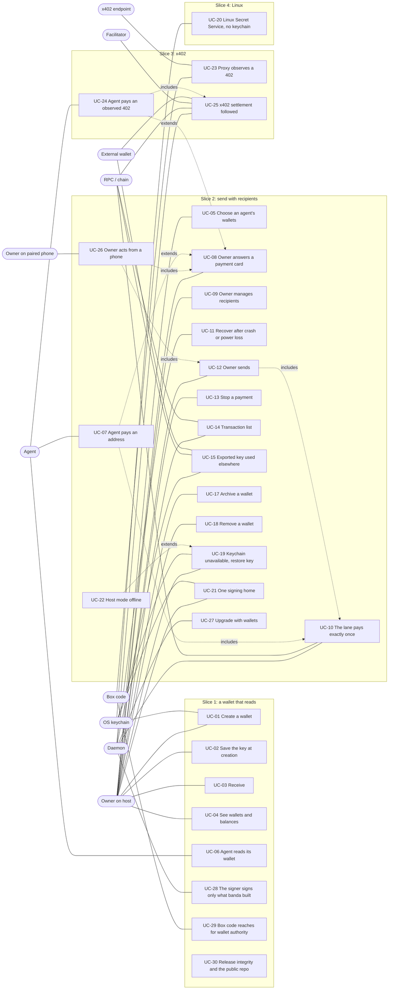

# Wallet use cases

Status: analysis for the RFC in [`../wallets.md`](../wallets.md), dated 2026-11-23. Nothing here is a DESIGN.md rule
(principle 6). It turns the owner's requirements into the use cases that must be implemented, each traced to the
hazards it covers ([`hazards.md`](hazards.md), H-ids), the rules that decide its races ([`conflicts.md`](conflicts.md),
C-ids), the model rows that fix its outcomes ([`model/transitions.json`](model/transitions.json)) and the RFC slice that
ships it. The scenarios that validate them are in [`features/`](features/), written in the vocabulary of
[`features/STEPS.md`](features/STEPS.md) and run under [`features/ISOLATION.md`](features/ISOLATION.md).

`features/check_features.py` checks this file: every hazard of `hazards.md` is listed under at least one use case
below (in scope or out), and every hazard a scenario is tagged with is listed under one of that scenario's use cases.

## Requirements (from the RFC)

| # | Requirement | Use cases |
|---|---|---|
| R1 | EVM, non-custodial; private keys in the OS keychain | UC-01, UC-19, UC-20, UC-21, UC-28 |
| R2 | Agents spend what the owner puts in a wallet; the balance is the only cap | UC-07, UC-10, UC-24 |
| R3 | Approval per recipient (address or x402 endpoint): Always, Ask, Deny; the first payment to an unknown recipient asks; the answer sets the rule; no amount limit | UC-07, UC-08, UC-09, UC-24 |
| R4 | Recipients can be renamed (a label, never the identity) | UC-09 |
| R5 | The private key can be exported at the wallet's creation | UC-02 |
| R6 | Several EVM accounts per home; the owner picks which wallet each agent may use | UC-01, UC-04, UC-05 |
| R7 | Settings has a Wallets section; each wallet has Send, Receive and a transaction list | UC-03, UC-04, UC-12, UC-14 |

## Actors

| Actor | Kind | Trust (hazards.md "Trust assumptions") | What it does here |
|---|---|---|---|
| **Owner on host** | primary, human | trusted (TA-1): the OS account banda runs under | creates, funds, reveals and saves keys, answers cards, sets rules, sends, archives, removes, restores keys; the only actor who can see a key |
| **Owner on paired phone** | primary, human, through a device token | trusted as the owner, but a device token is weaker than the host (OD-2, OD-3) | answers cards, sends to recipients the wallet already knows, renames, sets rules; never sees a key; a new address is confirmed on the host |
| **Agent** | primary, software | untrusted (TA-3): the model can be steered by any page | calls `wallet__address`, `wallet__balance`, `wallet__history`, `wallet__recipients`, `wallet__send`, `wallet__pay_x402`; can request, never admit |
| **Box code** | secondary, adversarial | untrusted (TA-3) | the agent's code: makes the HTTP requests whose 402s the proxy observes, retries with `PAYMENT-SIGNATURE`; may try to forge challenges, read keys or reach owner routes |
| **Daemon** | system | trusted (TA-2) | admits calls (C3), runs each wallet's lane (C2), commits every decision on one line (C1), follows receipts, indexes incoming rows, runs the signer child |
| **OS keychain** | secondary, system | trusted for storage, not as an arbiter (keychain spike) | holds one item per wallet under `<home-id>/wallet/<address>`; can lock, prompt, hang or lose an item |
| **RPC / chain** | secondary, external | RPC untrusted for what it reports (TA-4); consensus trusted at `finalized` (TA-5) | serves balances, counts, receipts, logs; accepts raw transactions; mines, reorgs, finalizes |
| **x402 endpoint** | secondary, external, possibly hostile | untrusted | answers the box's request with `402` and a `PAYMENT-REQUIRED` challenge; serves the paid retry |
| **Facilitator** | secondary, external | untrusted (its `PAYMENT-RESPONSE` is a claim) | submits the EIP-3009 authorization on chain for the endpoint |
| **External wallet holding the exported key** | secondary, external | the owner's own other wallet, outside banda's view | can send at the wallet's nonces (a foreign transaction) and cancel authorizations |

## Conventions

- **Machines** name the rows of `model/transitions.json` a use case drives; its scenarios replay those rows.
- **Hazards** lists every case of `hazards.md` the use case must hold. A hazard tagged on a scenario is validated by
  the scenario; the rest are validated as **V&V outside the scenarios** says (a unit, property, fault, browser or CI
  test), because their outcome is structural (what the box can reach, the key format, the supply chain) or lies below
  the model's abstraction (amount parsing, error messages, RPC classification). `check_features.py --coverage` lists
  them per use case.
- Flows name the C-rule that decides each race. "The card" is the payment card the daemon draws (RFC, "The first
  payment's card").

---

## In scope

### UC-01 · Create a wallet

- **Slice:** 1 · **Requirements:** R1, R6 · **Actors:** Owner on host (primary), Daemon, OS keychain · **Machines:**
  `wallet` (create, keychain_write, read_back, restart)
- **Preconditions:** the home is open on the host; the keychain is usable or not (both handled); the owner picked a
  name and a network (one network per wallet, fixed at creation: R-11, OD-9).
- **Main flow:**
  1. The owner taps Create wallet in Settings → Wallets (or "Give Mara a wallet"); the client sends a request id made
     when the form opened (C14).
  2. The signer child draws 32 bytes (`randomSecretKey` over `crypto.getRandomValues`), refuses 0 and ≥ n, derives the
     address; the daemon commits the wallet `creating` with the address and the request id (C15, R-13).
  3. The signer checks that `<home-id>/wallet/<address>` is empty, writes the key, reads it back and derives again.
  4. The daemon commits the wallet ready, **not backed up** (`ready_unsaved`), switched on for no agent.
  5. The Save your key step opens (UC-02). Receive stays withheld until that step ends (H-005).
- **Alternative flows:**
  - A1 Double tap or a retried request with the same request id: one wallet (C14, H-007).
  - A2 Two devices submit distinct requests at once: two wallets, two keys, two items; the keychain calls run one at a
    time per home (C20, H-036).
  - A3 Created from a paired phone: allowed; the wallet is Not backed up and the phone says "see the key on your
    computer" (H-276, UC-26).
- **Error flows:**
  - E1 The keychain does not answer at the write or the read-back (locked, prompt unanswered, no Secret Service): the
    wallet stays `creating`, the owner is told why, and the create resumes when the keychain answers (C20, H-018).
  - E2 An item already exists under the account (planted, or another key): the record is dropped and nothing is
    overwritten (C15, H-024).
  - E3 The read-back returns another key or nothing: the record is dropped; no address is ever shown whose key is not
    durably in the keychain (C15, H-006).
  - E4 The daemon is killed before, between or after the write: at start a `creating` record is reconciled from the
    item: present and deriving means ready and the Save step is offered again; otherwise the record is dropped; an
    item without a record is listed as an orphan, never adopted (C15, H-005, H-045).
  - E5 The random source fails: no wallet (H-002).
- **Postconditions:** a wallet record with address, network and keychain reference, never the key (H-011); exactly one
  keychain item per wallet; the wallet is on for no agent.
- **Hazards:** H-001, H-002, H-003, H-005, H-006, H-007, H-023, H-024, H-036, H-045
- **Rules:** C14, C15, C20
- **Scenarios:** `crash_boundaries.feature`, `wallet_lifecycle.feature`
- **V&V outside the scenarios:** H-002, H-003 (signer unit tests: a stubbed `getRandomValues` that throws, and 0, n and
  a 31-byte key refused, keys spike vectors); H-023 (unit test on the item's service and account strings); H-036 (a
  test that two concurrent creates make two signer calls in sequence).

### UC-02 · Save the private key at creation

- **Slice:** 1 · **Requirements:** R5 · **Actors:** Owner on host · **Machines:** `wallet` (reveal, confirm_saved,
  skip_save)
- **Preconditions:** the wallet is ready (`ready_unsaved`, or later `ready_skipped` / `ready_saved` for a later reveal,
  OD-2); the client that created it is in front (the desktop app, a Linux desktop, `banda serve` in a loopback browser
  or `banda wallet create` on the host's terminal).
- **Main flow:**
  1. The owner taps Show. At creation the ready commit already minted a creation capability for the create request
     id, consumable once within 10 min by the client that sent it, before the address is shown; no OS
     re-authentication is needed, so requirement 5 holds on every platform (C16). A later reveal needs the host's
     capability: the desktop shell asks for an OS re-authentication (Touch ID or password; none exists on Linux, so a
     later reveal there is open) and mints a one-time capability bound to the wallet, valid 60 s.
  2. The daemon consumes the capability in the reveal's commit and the signer reads the key; the app shows `0x` + 64
     lowercase hex beside the address it opens (keys spike: raw key, imported by MetaMask and `cast`).
  3. The owner copies it (the clipboard is cleared after 60 s where the platform allows) and saves it elsewhere.
  4. The owner pastes it back; the daemon derives the address and compares (R-8); on a match the wallet is backed up
     (`ready_saved`).
- **Alternative flows:**
  - A1 The owner skips: the wallet is marked Not backed up (`ready_skipped`); Receive opens; one quiet reminder when
    the balance first exceeds a small amount (H-273).
  - A2 A later reveal (weeks after): the host's capability path, listed in the wallet's activity (H-266).
- **Error flows:**
  - E1 The paste does not derive the address: the wallet stays Not backed up and the owner is told the copy is wrong,
    while the key is still in the keychain (H-275).
  - E2 The reveal comes from a paired device, a browser device or a local process with the owner's token alone:
    refused, "open banda on your computer" (C16, H-264, H-267).
  - E3 The capability is replayed or expired: refused (C14, C16, H-268).
  - E4 The keychain does not answer or the item is not ours: no reveal (H-021).
  - E5 The daemon is killed during the reveal: the capability is spent; the owner asks again (H-269).
- **Postconditions:** the key left the keychain only to the host's screen and clipboard; the store records that a
  reveal happened, never the key.
- **Hazards:** H-008, H-263, H-266, H-267, H-268, H-269, H-270, H-271, H-273, H-274, H-275, H-281
- **Rules:** C14, C15, C16
- **Scenarios:** `key_export.feature`
- **V&V outside the scenarios:** H-008 (keys spike vectors: 2000 keys round-trip, raw-key format); H-269, H-270,
  H-271, H-274, H-281 (browser tests of the reveal screen: content protection flag, clipboard clear timer, the key
  dropped from component state on leave, `aria-hidden` on the key text).

### UC-03 · Receive

- **Slice:** 1 · **Requirements:** R7 · **Actors:** Owner on host or phone; RPC / chain · **Machines:** `wallet`
  (show_receive)
- **Preconditions:** the wallet is ready and its save step ended (saved or skipped).
- **Main flow:** the owner opens Receive; the app shows the EIP-55 address, the network, and a QR of the plain
  checksummed address (OD-7); incoming funds appear in the transaction list's incoming rows, which ship in slice 1
  (UC-14 A3).
- **Code at the address:** when `eth_getCode` returns code (an EIP-7702 delegation made with the exported key),
  Receive and the QR give way to a warning and owner Send waits for an acknowledgement on the host (C17, H-157).
- **Alternative flows:** A1 Funds sent on another EVM chain to the same address: the screen says which network the
  wallet uses; recovery is the owner's, with the exported key (H-260).
- **Error flows:** E1 Receive asked while the save step is open: withheld; the save step is shown instead (H-005).
- **Postconditions:** the address shown is the one the record holds and the key derives (H-261).
- **Hazards:** H-005, H-258, H-259, H-260, H-261, H-157
- **Rules:** C15, C16
- **Scenarios:** `key_export.feature`, `owner_send_receive.feature`
- **V&V outside the scenarios:** H-259 (QR payload unit test; EIP-681 stays out until a spike, OD-7); H-260 (copy
  test of the network line); H-261 (a test that Receive renders the record's address and that the record's address is
  what the signer derived at creation).

### UC-04 · See wallets and balances in Settings → Wallets

- **Slice:** 1 · **Requirements:** R6, R7 · **Actors:** Owner on host or phone; RPC / chain · **Machines:** `signing`
  (the offline reasons it shows)
- **Preconditions:** the home is open.
- **Main flow:** Settings → Wallets lists every wallet with its name, network, balance (native and USDC, dated by the
  block read), backup mark, the agents it is on for, and its offline reason if any; the RPC per network is a named
  choice with what it learns said plainly.
- **Alternative flows:** A1 No wallet yet, or no keychain: an empty state saying what to do (H-309). A2 The owner
  changes the RPC: in-flight payments keep their stored bytes (H-192).
- **Error flows:** E1 Balance unknown (RPC down): shown as unknown, never as zero (H-208 in UC-14). E2 An offline
  wallet shows one reason from one list (H-317).
- **Postconditions:** nothing is written; every figure is derived and dated (C22).
- **Hazards:** H-039, H-040, H-041, H-192, H-195, H-196, H-309, H-315, H-317
- **Rules:** C22, C8
- **Scenarios:** `keychain_signing.feature`
- **V&V outside the scenarios:** H-039, H-040, H-041, H-309, H-315 (browser tests at desktop and phone width with
  three wallets on two networks, names with control characters); H-195, H-196 (unit tests on the RPC URL check and the
  key redaction); H-192 (fault test: change the RPC between start commit and receipt).

### UC-05 · Choose which wallets an agent may use

- **Slice:** 1 (switch) and 2 (effect on payments) · **Requirements:** R6 · **Actors:** Owner on host or phone ·
  **Machines:** `payment` (call with `wallet_usable`, cancel_or_switch_off)
- **Preconditions:** the wallet exists and is not archived.
- **Main flow:** in the agent's settings (or the wallet's), the owner switches the wallet on for the agent, as for any
  account of a connection; the agent's tools now list that wallet, and only the wallets on for it (H-071).
- **Alternative flows:** A1 Two agents share a wallet: they share its balance (the cap) and its Deny rules; each keeps
  its own Always rules (OD-1, H-159). A2 An agent with two wallets names one in its call; an unnamed call to an agent
  with two wallets is refused with the list (H-057).
- **Error flows:** E1 An agent calls with a wallet not on for it: refused at admission, step 2 of C3 (H-053). E2 The
  wallet is switched off while the agent's payment waits or is queued: refused in the switch-off's commit (C17,
  H-054); past the burn point it finishes (C13).
- **Postconditions:** the agent's access is a store fact read by every admission and every start commit.
- **Hazards:** H-051, H-053, H-054, H-057, H-058, H-071, H-159
- **Rules:** C3, C4, C17
- **Scenarios:** `agent_access.feature`, `races.feature`
- **V&V outside the scenarios:** H-057, H-058, H-071 (unit tests of the per-agent tool schema: the wallet enum names
  only the agent's wallets, a label required; banda-integration spike found `multiAccount` listing every account);
  H-159 (copy test on the sharing notice).

### UC-06 · Agent reads its wallet

- **Slice:** 1 (address, balance) and 2 (history, recipients) · **Actors:** Agent, Daemon, RPC / chain ·
  **Machines:** none (reads)
- **Preconditions:** the wallet is on for the agent.
- **Main flow:** `wallet__address` gives the address and network; `wallet__balance` the native and listed tokens,
  dated; `wallet__history` the agent's own payments with their states, from the store; `wallet__recipients` the names
  and rules, so the agent knows whom it may pay before trying.
- **Alternative flows:** A1 The agent has no wallet: the tools are absent and the agent says it has none (H-056).
- **Error flows:** E1 The balance is unknown: "unknown", never 0 (H-208).
- **Postconditions:** nothing is written; long histories are paged (H-214).
- **Hazards:** H-056, H-070, H-072, H-206, H-209
- **Rules:** C22
- **Scenarios:** `transaction_list.feature`
- **V&V outside the scenarios:** H-056, H-072 (`test/prompt-budget.test.ts` re-measured: the wallet tools appear only
  for an agent with a wallet); H-070, H-206, H-209 (unit tests of the read tools' output shape and paging).

### UC-07 · Agent pays an address

- **Slice:** 2 · **Requirements:** R2, R3 · **Actors:** Agent (primary), Daemon, Owner (when asked) · **Machines:**
  `payment` (call), `recipient`
- **Preconditions:** the wallet is on for the agent; `wallet__send` is on.
- **Main flow:**
  1. The agent calls `wallet__send(to, amount, token)`.
  2. The daemon admits it in C3's fixed order: wallet usable, agent on, tool on, arguments parse (decimal string in
     the token's units), the recipient's canonical identity (EIP-55 on the wallet's network; not zero, the token, the
     wallet itself or a precompile), the wallet can sign, the rule (Deny > Always > Ask > default), the available
     balance after reservations and fees (C11), the limits.
  3. Always: the payment is queued in the wallet's lane (UC-10) and a card shows in the chat as a record.
  4. Ask or unknown under the default Ask: a card asks the owner (UC-08).
- **Alternative flows:** A1 The wallet's default is Deny: an unknown recipient is refused with words, no card (H-090).
  A2 The agent pays from within a group: the payment is the agent's, the card goes to the owner (H-059).
- **Error flows:** E1 Deny: refused in words ("the owner doesn't pay 0x9f…"), no card (H-076). E2 The balance does not
  cover it: refused with the available amount, no card (OD-8, H-132, H-134). E3 A malformed amount or a unit mix-up:
  refused at parse (H-137, H-138, H-139). E4 A destination that cannot receive (zero, the token, the wallet itself, a
  contract without a payable path): refused at step 5 (H-102, H-103, H-105). E5 A duplicate of an open ask (same agent, recipient,
  amount and token): answered with the open card, never a second one; asks are never refused by count (H-100). E6 The wallet cannot be used (archived, not on, offline): refused at step 1, 2 or 6.
- **Postconditions:** a refused call holds nothing; a waiting or queued payment holds a reservation and no nonce (R-1).
- **Hazards:** H-059, H-073, H-074, H-075, H-076, H-093, H-094, H-095, H-096, H-097, H-100, H-102, H-103, H-104, H-105, H-132, H-134, H-135, H-137, H-138, H-139, H-148, H-156, H-157, H-098, H-149
- **Rules:** C3, C11, C18
- **Scenarios:** `payments.feature`, `races.feature`
- **V&V outside the scenarios:** H-093, H-094, H-095, H-104 (property test: every spelling of one address admits to
  one identity; look-alikes flagged on the card; no remote name resolution); H-100, H-102, H-103, H-105, H-137,
  H-138, H-139, H-148, H-156, H-157 (property test of C3 over generated calls and stores: the answer is a function of
  inputs and store); H-135 (unit test: USDC without ETH for gas refused with the reason); H-059 (route test: an agent
  paying from within a group pays as itself, its own rules apply, and the card goes to the owner, never to the group's
  other members); H-098, H-149 (the balance is the only cap the owner chose, R2: PaymentLane's `SpentWithinFunded` and
  `AlwaysNeverAsks`, and a property test that a loop of Always payments spends at most the wallet's balance and opens
  no card; the burst pause is OOS-11).

### UC-08 · Owner answers a payment card

- **Slice:** 2 · **Requirements:** R3 · **Actors:** Owner on host or phone · **Machines:** `payment` (card_pay,
  card_always, card_dont_pay, card_never), `recipient` (card_*)
- **Preconditions:** a payment waits for the owner (`Waiting`).
- **Main flow:** the card shows amount and token (and a dated estimate in the owner's currency, H-163), the recipient
  as identified (never only a label), the wallet and its balance after, and the agent's reason as the agent's words
  (H-101). The owner may name the recipient, then taps one of:
  - **Pay**: this once; the rule becomes Ask (C9);
  - **Always pay {name}, up to what's in the wallet**: pays and sets Always for this agent; every other open card it
    covers is answered in the same commit (C9, H-083);
  - **Don't pay**: this once;
  - **Never pay {name}**: refuses and sets Deny for the wallet; every open card and queued payment for it is refused
    (C9, H-084).
- **Alternative flows:** A1 A shared wallet: the second agent's first card offers "Always pay Ana for Sancho too"
  (R-7, H-091). A2 The card is answered on the phone and on the desktop: the first commit wins, the other is told
  (C8, H-141). A3 The owner answers Always in the morning for the night's routine (H-311).
- **Error flows:** E1 The owner says "yes" in the chat: not an answer; only the card's route answers (C9, H-140).
  E2 A reviewer model or another agent tries to answer: no route (H-068). E3 The rule changed to Deny before the
  owner taps Pay: Deny wins at the start commit (C4, H-082).
- **Postconditions:** the payment is Queued or Refused; the recipient's rule is what the answer set.
- **Hazards:** H-068, H-073, H-075, H-078, H-082, H-083, H-084, H-091, H-101, H-140, H-141, H-163, H-311
- **Rules:** C8, C9, C4
- **Scenarios:** `payments.feature`, `races.feature`, `recipients.feature`
- **V&V outside the scenarios:** H-068, H-140 (route tests: only the owner's card route answers a wallet Wait); H-078,
  H-101, H-163 (browser tests of the card: the agent's proposed name is a suggestion field, the reason is quoted, the
  estimate is dated and labelled).

### UC-09 · Owner manages recipients

- **Slice:** 2 · **Requirements:** R3, R4 · **Actors:** Owner on host or phone · **Machines:** `recipient`
  (list_set_*, rename, forget), `payment` (deny_committed, always_committed, start_commit)
- **Preconditions:** the wallet has recipients (from cards or set up in the list).
- **Main flow:** the agent's settings → wallet → Recipients lists each recipient with its name, identity, rule, what
  was paid to it and when; the owner renames it, changes its rule, or forgets it; each act carries the version it saw
  (C8).
- **Alternative flows:** A1 Rename: every card and list shows the new name; the rule binds the identity and never
  moves (C18, H-080, H-077). A2 The default for unknown recipients changes from Ask to Deny: open asks for unknown
  recipients are refused in the same commit (C9, H-090). A3 Forget: the recipient returns to unknown; its next payment
  asks (H-089).
- **Error flows:** E1 A stale version (another device acted first): refused, the screen redraws (C8, H-109). E2 Deny
  set while a payment of that recipient is queued: refused at the start commit or in the Deny's sweep (C4, C9, H-086);
  past the burn point it finishes and is reported (C13, H-085). E3 Always taken back (to Ask) or forgotten while an
  Always payment is queued: the start commit sends it back to the owner (C4, H-087, H-088).
- **Postconditions:** rules are keyed by identity: Deny and the label per (wallet, recipient), Always per (wallet,
  agent, recipient) (OD-1).
- **Hazards:** H-077, H-079, H-080, H-081, H-084, H-085, H-086, H-087, H-088, H-089, H-090, H-109
- **Rules:** C4, C8, C9, C13, C18
- **Scenarios:** `payments.feature`, `races.feature`, `recipients.feature`
- **V&V outside the scenarios:** H-079 (browser test: two recipients with one name both show their identity); H-090
  (the default's sweep is in the payment's `deny_committed` row; a unit test checks that a default change emits it for
  every unknown-recipient ask).

### UC-10 · The lane pays exactly once

- **Slice:** 2 · **Requirements:** R2 · **Actors:** Daemon (primary), OS keychain, RPC / chain · **Machines:**
  `payment` (sign, start_commit, broadcast, bump, receipt, reorg, finality), `nonce`
- **Preconditions:** a payment is Queued in the wallet's lane (C2: one lane per wallet, FIFO).
- **Main flow:**
  1. The lane takes its head payment; the signer child reads the key, proves it derives the address and holds the
     lease (C16), and signs an EIP-1559 transfer with `extraEntropy: false` and an explicit chain id (C20, stack.md).
  2. One commit (the burn point, C4): re-check the payment (still Queued), C3 steps 1, 2, 6, 7, 8, the approval's
     freshness (C10); take nonce = ledger with compare-and-set (C4); append the signed version; move to Signed. It is
     synced before the broadcast (C21).
  3. Broadcast the committed bytes (idempotent: a rebroadcast is harmless, nonce spike section 2).
  4. Follow the receipt: Included at `latest`; Confirmed, Failed (status 0) and Cancelled (the owner's cancel mined)
     only at `finalized`; "Included (safe)" is a display, not a state (C12, R-4).
- **Alternative flows:** A1 Not included because the base fee rose: a new version at the same nonce, both fees +12.5%,
  committed before it is broadcast; any version's receipt settles (C6, H-172, H-175). A2 A reorg returns the payment
  to Sent; its stored bytes are rebroadcast (C5, C12, H-176, H-181). A3 The ledger moved since signing (another
  driver): the bytes are dropped and the payment is signed again (C4, H-171).
- **Error flows:** E1 The key cannot be read (locked, missing, other home): the payment stays Queued, nothing is
  burnt, the lane waits with one owner Wait (H-026, H-027). E2 The re-check fails: Deny → Refused; approval stale or
  rule now Ask → back to Waiting; balance short → Refused (C4, H-133). E3 Status 0: Failed (H-147). E4 An RPC that lies
  about a receipt or a count: nothing is decided on a claim; a foreign transaction or a status 0 counts only when the
  transaction is fetched, its signer recovers to the wallet at the nonce and a second RPC agrees (C7, C12, H-188, H-189).
  E5 Evicted or never forwarded: rebroadcast every unconfirmed version in nonce order (H-179, H-180).
- **Postconditions:** exactly one transaction per payment on chain; nonces contiguous; the ledger equals the chain at
  finality; the tool reports the lane's stored outcome.
- **Hazards:** H-026, H-027, H-049, H-112, H-127, H-128, H-133, H-136, H-143, H-145, H-147, H-158, H-164, H-165, H-172, H-173, H-174, H-175, H-176, H-178, H-179, H-180, H-181, H-182, H-183, H-184, H-185, H-186, H-187, H-188, H-189, H-190, H-191, H-200, H-298
- **Rules:** C2, C4, C5, C6, C12, C20, C21
- **Scenarios:** `lane_and_nonce.feature`, `payments.feature`, `races.feature`
- **V&V outside the scenarios:** H-049 (fault test: start a lane twice); H-127, H-128 (unit tests: the checkpoint is a
  ledger doc, not a memo; values copied out of commits); H-136, H-145, H-174, H-178, H-190 (unit tests of the fee
  reserve with the GasPriceOracle's `getL1FeeUpperBound` on an anvil Base fork); H-158, H-182, H-183, H-184, H-185,
  H-186, H-187 (error classifier table tests against anvil, and op-geth or base-reth in Docker in CI, nonce spike
  error table); H-200 (fault test: a filler that cannot be sent leaves the lane blocked with the reason); H-298 (scan
  test: signed bytes only in the ledger doc); H-191 (lying-RPC balance test: every balance reading is stored with its
  block number and the commit uses the stored reading; a second RPC disagreeing or down makes the balance unknown,
  which refuses).

### UC-11 · Recover after a crash or power loss

- **Slice:** 2 · **Actors:** Daemon · **Machines:** `payment` (crash), `nonce` (crash), `wallet` (restart), `x402`
  (crash)
- **Preconditions:** a payment, an authorization or a creation is in any non-terminal state.
- **Main flow:** at start, after migrations (C23), the lanes and the follower resume from the last commit: a payment
  before its start commit is re-signed (nothing was burnt); a Signed payment rebroadcasts its committed bytes; a Sent
  one follows its receipt; nothing is ever signed at a second nonce for one payment (C4, C6).
- **Alternative flows:** A1 An interrupted payment's card offers Pay once and Deny, never Always (C10, H-092). A2 Power
  loss: the start commit was synced before its broadcast (C21); a chain count above the ledger that stored hashes do
  not explain freezes the lane until the owner acts (H-129).
- **Error flows:** E1 A commit fails (disk full) before the broadcast: nothing left the machine; after a broadcast: the
  bytes are stored, the follower finishes it (H-130, H-131). E2 A stored state crashes the lane at every start: the lane
  parks that payment with its reason, others continue (H-123).
- **Postconditions:** the invariants I1 to I8 of conflicts.md hold after every kill.
- **Hazards:** H-092, H-113, H-114, H-115, H-116, H-117, H-118, H-119, H-120, H-121, H-122, H-123, H-125, H-129, H-130, H-131, H-193, H-202
- **Rules:** C4, C6, C10, C13, C21, C23
- **Scenarios:** `crash_boundaries.feature`, `lane_and_nonce.feature`
- **V&V outside the scenarios:** H-092 (unit test of the card's offered answers after a restart); H-123, H-125, H-130,
  H-131 (fault tests under `test/fault/`: thrown commit errors at `wallet:stored` and `wallet:broadcast`, and a poison
  entry); H-193 (fault test with the injected clock advanced by days).

### UC-12 · Owner sends from a wallet

- **Slice:** 2 · **Requirements:** R7 · **Actors:** Owner on host (primary), Owner on phone, Daemon · **Machines:**
  `payment` (payer owner)
- **Preconditions:** the wallet is ready and not archived.
- **Main flow:** Send → recipient (typed, pasted or picked from recipients), amount and token → review (full address,
  network, fee estimate) → confirm with a request id made when the review opened (C14); the payment enters the same
  lane as the agents' payments, never ahead of them (C2, H-254), and follows UC-10.
- **Alternative flows:** A1 The recipient is set to Deny for agents: the owner may still send; the owner's Send grants
  agents nothing (H-106, H-107). A2 "Send all" of ETH keeps a fee reserve (H-146).
- **Error flows:** E1 The balance does not cover it: refused before the lane (C11). E2 An invalid address, or an
  amount in another locale or with too many decimals: refused at review (H-255, H-256). E3 Submitted twice: one
  payment (C14, H-253). E4 A foreign transaction took its nonce: it waits at finality for the owner (C7).
- **Postconditions:** the Send is a row of the transaction list with its states (UC-14).
- **Hazards:** H-106, H-107, H-146, H-252, H-253, H-254, H-255, H-256, H-257, H-262
- **Rules:** C2, C11, C14
- **Scenarios:** `owner_send_receive.feature`
- **V&V outside the scenarios:** H-146, H-255, H-256, H-257 (browser and unit tests of the Send form and its parser);
  H-253, H-262 (route test: the request id is required and deduplicated; an old client without one is refused).

### UC-13 · Stop a payment: cancel the run, switch off, archive, deadline

- **Slice:** 2 · **Actors:** Owner, Daemon (timers) · **Machines:** `payment` (cancel_or_switch_off, deadline)
- **Preconditions:** a payment is Waiting, Queued, Signed, Sent or Included.
- **Main flow:** the owner cancels the chat's run, switches the wallet off for the agent, archives the wallet or the
  agent: before the burn point the payment is refused in that commit (C17); after it, the payment finishes and the
  tool reports the lane's outcome, "may have sent" until a receipt decides (C13).
- **Alternative flows:** A1 Nobody answers an Ask (a routine at night): after 24 h, "Not paid: no answer" (C10, H-310).
  A2 Approved, then held behind a stuck transaction for hours: the approval is stale and asks again (H-144).
- **Error flows:** E1 A rerun after a crash under a Deny set meanwhile: reports the lane's outcome, never "did not run"
  for bytes that left (C13, H-126; banda-integration spike reproduced it on banda's real `effectRun`).
- **Postconditions:** no payment is reported refused while its bytes can still land.
- **Hazards:** H-047, H-054, H-055, H-111, H-124, H-126, H-142, H-144, H-177, H-194, H-199, H-310
- **Rules:** C10, C13, C17
- **Scenarios:** `agent_access.feature`, `crash_boundaries.feature`, `payments.feature`, `races.feature`
- **V&V outside the scenarios:** H-111 (unit test: rules keyed by a deleted agent go with it); H-177, H-199 (the
  owner's cancel replacement is a later slice; fault test that the lane's bump and a cancel stay versions in lane
  order); H-194 (fault test: wall-clock jumps do not move the store's timers).

### UC-14 · Owner sees the transaction list

- **Slice:** 1 (incoming rows) and 2 (outgoing rows) · **Requirements:** R7 · **Actors:** Owner on host or phone,
  Daemon (indexer), RPC / chain · **Machines:** `payment` (the states it shows)
- **Preconditions:** the wallet exists.
- **Main flow:** the list shows outgoing rows from the store (every state: Waiting, Queued, Signed "may have sent",
  Sent, Included, Confirmed, Failed, Cancelled, Refused, Not paid, Restored), x402 payments from their authorizations, incoming USDC from
  `eth_getLogs` on the pinned token, incoming ETH from balance bisection, and "sent outside banda" for a nonce move
  with no stored effect (stack.md section 7, tx-history spike).
- **Alternative flows:** A1 A reorg removes an incoming row: it is rebuilt from the chain (H-213). A2 A long history
  is paged (H-214). A3 Slice 1, before any send exists: the list holds the incoming rows alone (USDC from `Transfer`
  logs, ETH by balance checkpoints), so a funded wallet shows its funds arriving (principle 9).
- **Error flows:** E1 The RPC cannot serve logs (`mainnet.base.org` answered 429 to every `eth_getLogs`): Settings
  says so and the list says how far back it is complete (H-207). E2 Dust from a look-alike address: shown as incoming,
  never offered as a recipient (H-205).
- **Postconditions:** the list is derived and rebuildable (C22); what it says matches the chain (`ReportedIsTrue`).
- **Hazards:** H-160, H-198, H-201, H-203, H-204, H-205, H-207, H-208, H-210, H-211, H-212, H-213, H-214, H-215, H-312, H-314
- **Rules:** C12, C22
- **Scenarios:** `transaction_list.feature`
- **V&V outside the scenarios:** H-160, H-203, H-204, H-205, H-207, H-210, H-212, H-213, H-215 (indexer tests on
  anvil reproducing the tx-history spike: pinned-token filter, zero-value drop, bisection for contract ETH and
  SELFDESTRUCT, upserts by (hash, log index), range re-probe); H-198 (unit test: one poller and one filter per
  network); H-208, H-211, H-214, H-312, H-314 (browser tests of the list).

### UC-15 · The exported key is used in another wallet

- **Slice:** 2 · **Actors:** External wallet holding the exported key, Daemon, RPC / chain · **Machines:** `payment`
  (receipt with a foreign transaction), `nonce` (lane_turn with chain ahead, foreign_at_nonce, finality)
- **Preconditions:** the owner exported the key (UC-02) and sends from it elsewhere.
- **Main flow:** a nonce used on chain by a transaction the store does not hold is foreign. While banda was idle: the
  lane is blocked until that count is finalized, then the ledger is raised (C5, C21, H-166). While banda's payment was
  in flight at that nonce: the payment waits until the foreign transaction is finalized, then asks the owner again on
  a card that says what happened (C7, H-167).
- **Alternative flows:** A1 A reorg removes the foreign transaction before finality: banda's version lands instead,
  once (nonce spike section 8).
- **Error flows:** E1 Two foreign events within 24 h: the lane pauses (C7). E2 The RPC reports a count below the
  ledger: the ledger never moves down (H-170).
- **Postconditions:** the payment is on chain at most once; the ledger is raised only at finalized.
- **Hazards:** H-166, H-167, H-168, H-169, H-170, H-171
- **Rules:** C5, C7, C21
- **Scenarios:** `lane_and_nonce.feature`, `owner_send_receive.feature`, `payments.feature`, `races.feature`
- **V&V outside the scenarios:** H-168, H-169, H-170 (fault tests on anvil with a second sender using the same key,
  nonce spike section 5).

### UC-17 · Archive and unarchive a wallet

- **Slice:** 2 · **Actors:** Owner on host or phone · **Machines:** `wallet` (archive, unarchive)
- **Preconditions:** the wallet is ready.
- **Main flow:** archive hides the wallet from agents and refuses its open asks and queued payments in the same commit
  (C17); an archived wallet does not send; unarchive brings it back with its backup mark.
- **Alternative flows:** A1 Funds arrive after archive: the list still shows them; the wallet can be unarchived
  (H-046).
- **Error flows:** E1 A stale version: refused, the screen redraws (C8, H-050). E2 The owner's Send races the archive:
  commit order decides; an archived wallet does not send (H-047).
- **Postconditions:** the key stays in the keychain; nothing is lost.
- **Hazards:** H-042, H-046, H-047, H-050
- **Rules:** C8, C17
- **Scenarios:** `races.feature`, `wallet_lifecycle.feature`

### UC-18 · Remove a wallet

- **Slice:** 2 · **Actors:** Owner on host, OS keychain · **Machines:** `wallet` (begin_remove, delete_item,
  item_gone)
- **Preconditions:** the wallet is ready or archived.
- **Main flow:** the owner removes it; the daemon refuses while any version is non-terminal, any authorization is
  live, the balance at `safe` is above zero, or the address left banda (Receive, an agent's read, a transaction)
  while the key was never confirmed saved (C17); otherwise it
  commits `removing`, deletes the keychain item, and commits `removed` (C15).
- **Alternative flows:** A1 Funds arrive while removing: the re-check at the delete cancels the removal and archives
  the wallet (C17, H-046).
- **Error flows:** E1 The keychain does not answer at the delete: `removing` holds and retries (H-044). E2 A reveal
  while removing: refused once `removing` committed (H-048). E3 Killed between the store and the keychain: the start
  finishes the removal from `removing` (C15, H-044).
- **Postconditions:** no item without a record; no wallet removed with funds or work in flight.
- **Hazards:** H-043, H-044, H-046, H-048
- **Rules:** C15, C17
- **Scenarios:** `wallet_lifecycle.feature`

### UC-19 · The keychain is unavailable, and the owner restores the key

- **Slice:** 1 (macOS) and 4 (Linux) · **Requirements:** R1 · **Actors:** OS keychain, Owner on host, Daemon ·
  **Machines:** `signing`
- **Preconditions:** a ready wallet.
- **Main flow:** at every unlock the signer derives the address from the key and compares it with the record, and
  checks the lease (C16). The wallet's offline reason is one of: locked, key missing, wrong key, other home, host
  mode. A missing key is told apart from a keychain that cannot answer by a canary account `<home-id>/probe` (H-037).
- **Alternative flows:** A1 The keychain unlocks: online again; the lane resumes in FIFO order (H-026). A2 Restore key:
  the owner pastes the exported key; it must derive the record's address (OD-6, H-014); the restore answers the lane's
  "key missing" Wait (C9, H-290).
- **Error flows:** E1 A keychain call blocks on a prompt nobody answers: the signer child is killed at its deadline;
  the daemon's thread pool is never used (keychain spike: the AbortSignal is ignored, four hung calls starve fs and
  crypto, H-018, H-032, H-034). E2 A late answer after the deadline is discarded (C14, H-035). E3 A release changes
  the Node binary: macOS asks once per wallet; the offline reason says what to click (H-017).
- **Postconditions:** banda never signs with a key that does not derive the address.
- **Hazards:** H-014, H-017, H-018, H-019, H-021, H-025, H-026, H-032, H-034, H-035, H-037, H-290
- **Rules:** C9, C14, C16, C20
- **Scenarios:** `key_export.feature`, `keychain_signing.feature`, `lane_and_nonce.feature`, `races.feature`, `wallet_lifecycle.feature`
- **V&V outside the scenarios:** H-017 (manual run on a signed release, keychain spike "Not run"); H-018, H-032,
  H-034, H-035 (fault tests: a fake keystore that never answers, the signer child killed at its deadline, `fs` and
  `crypto` still answering, the daemon exiting); H-019, H-037 (keystore unit tests with the canary).

### UC-20 · Linux Secret Service, and the headless "no keychain" state

- **Slice:** 4 · **Requirements:** R1 · **Actors:** OS keychain, Owner on host · **Machines:** `wallet`
  (keychain_write when it does not answer), `signing`
- **Preconditions:** banda runs on Linux.
- **Main flow:** every keychain entry is built with the store pinned to `secret-service`; with an unlocked collection
  create, sign and remove work as on macOS.
- **Alternative flows:** none.
- **Error flows:** E1 No Secret Service, no session bus, or no default collection: the write fails with a classified
  message and the wallet stays `creating` or offline, never stored in the kernel keyring (keychain spike: the default
  `auto` store silently fell back to keyutils, which is lost at reboot, H-029). E2 A locked collection with no display:
  "unlock prompt was dismissed" (H-028).
- **Postconditions:** no key is ever kept anywhere that does not survive a reboot; no file fallback.
- **Hazards:** H-028, H-029, H-309
- **Rules:** C20
- **Scenarios:** `keychain_signing.feature`
- **V&V outside the scenarios:** H-028, H-029, H-309 (the keychain spike's Docker scenarios `unlocked`, `locked`,
  `prompt`, `notstarted`, `nosecrets`, `nodbus` as a CI box suite, each message classified by a test).

### UC-21 · One signing home: a restored backup, a fork, a new computer

- **Slice:** 2 · **Actors:** Owner on host, OS keychain, Daemon · **Machines:** `signing` (unlock_check with the lease,
  lease_moved)
- **Preconditions:** two homes can reach one keychain item (a backup restored beside its original, an OS keychain
  backup) or a home has no home secret (a fork, a new computer).
- **Main flow:** only the home whose home secret matches the keychain's lease signs (C16, R-12); any other is offline,
  "another home signs for this wallet".
- **Alternative flows:** A1 The owner moves the lease to this home on the host after proving each key; the move writes
  the keychain's epoch first, then the store's (C15, H-289). A2 A restored home starts with a restore marker that
  turns pre-burn payments into owner Waits (H-285).
- **Error flows:** E1 The home secret is missing: offline, no automatic regeneration (H-287). E2 A lease move killed
  halfway: the start completes it from the keychain epoch (H-289).
- **Postconditions:** one signing home per wallet; a fork never spends (H-283).
- **Hazards:** H-020, H-022, H-283, H-284, H-285, H-286, H-287, H-288, H-289
- **Rules:** C15, C16
- **Scenarios:** `keychain_signing.feature`
- **V&V outside the scenarios:** H-022, H-285, H-286, H-287, H-288 (backup and `home:fork` tests: the home secret is
  outside everything a backup, restore or fork copies; a restore marker parks pre-burn payments).

### UC-22 · Host mode and boxless homes take wallets offline

- **Slice:** 2 · **Actors:** Daemon · **Machines:** `signing` (unlock_check with `host_mode`)
- **Preconditions:** the home runs with `--box host` (commands on the host as the owner).
- **Main flow:** the wallets are offline ("commands run on this computer can read wallet keys"), because code run as
  the owner reads every key (TA-1, H-064, H-065); x402 has no proxy to observe a 402 (H-243).
- **Alternative flows:** A1 The owner switches back to a box: online after the next check.
- **Error flows:** none.
- **Postconditions:** no signature while host mode is on.
- **Hazards:** H-064, H-065, H-243, H-316
- **Rules:** C3, C16, C20
- **Scenarios:** `keychain_signing.feature`
- **V&V outside the scenarios:** H-065, H-243, H-316 (box suite: the Docker box and the shipped computer give the same
  wallet tools; host mode lists the reason).

### UC-23 · The proxy observes a 402

- **Slice:** 3 · **Actors:** Box code, x402 endpoint, Daemon · **Machines:** `x402` (proxy_sees_402)
- **Preconditions:** the box's HTTPS request goes through the guarded proxy.
- **Main flow:** the endpoint answers 402 with `PAYMENT-REQUIRED`; the proxy, over upstream TLS it verified, records an
  observation (chat, origin, path, method, the decoded challenge) and hands the box only an observation id; intake
  commits it before the id reaches the box (C18, C21; banda-integration spike: an untrusted upstream gave 502 and no
  observation).
- **Alternative flows:** A1 A 402 after redirects: the observation is the final origin and path (H-229).
- **Error flows:** E1 Plain HTTP, an unverified certificate, x402 v1, a scheme other than `exact`, a transfer method
  other than EIP-3009, an asset other than the pinned USDC, a domain other than the table's, a `resource.url` other
  than the observed one: no observation (H-224, H-231, H-232; x402 spike step 7 refusals). E2 The observation is lost
  before intake: the agent's call finds nothing and says so (H-247).
- **Postconditions:** an observation exists only for what the proxy saw.
- **Hazards:** H-221, H-224, H-229, H-231, H-232, H-233, H-247
- **Rules:** C18, C21
- **Scenarios:** `x402.feature`
- **V&V outside the scenarios:** H-229, H-232, H-233, H-247 (box suite on the pinned mitmproxy image with the
  banda-integration spike's upstream: redirects, v1 bodies, the browser's 402s, an intake fault).

### UC-24 · Agent pays an observed 402

- **Slice:** 3 · **Requirements:** R2, R3 · **Actors:** Agent, Box code, Daemon, Owner (when asked) · **Machines:**
  `x402` (call, card_*, deadline, authorization_commit, hand_header, agent_pays_again)
- **Preconditions:** an observation recorded for the calling chat.
- **Main flow:**
  1. The agent calls `wallet__pay_x402(observation)`; the daemon runs an intake first (H-219).
  2. Admission: the observation belongs to the calling chat (C18), the rule for (wallet, agent, origin and path, payTo,
     asset, network), the available USDC after reservations (C11).
  3. Always, or Ask answered Pay: one commit stores the EIP-3009 message with the derived nonce
     `keccak256("banda/x402" ‖ wallet ‖ observation id)` (R-5), a window from chain time (`validBefore` ≤ t + 60 s,
     C19) and a reservation, before any signature.
  4. The signer signs; the commit is durable before the header leaves (C21); the box retries with
     `PAYMENT-SIGNATURE`.
- **Alternative flows:** A1 The agent pays the same observation again: the same authorization, never a second one
  (C14, H-227). A2 Two parallel requests to one Always endpoint: two observations, two authorizations, both reserved
  (H-238). A3 The payTo changed since Always was set: asks again (H-223).
- **Error flows:** E1 Another chat's observation: refused (C18, H-218). E2 Deny: refused. E3 Not enough USDC: refused
  (H-239, H-240). E4 The Ask is answered after 24 h: Not paid (C10, H-241). E5 A forged challenge in the arguments:
  the tool takes only an observation id (H-217).
- **Postconditions:** at most one settlement per observation; only observed terms signed; the signature reaches the
  box, the key never does.
- **Hazards:** H-108, H-194, H-216, H-217, H-218, H-219, H-220, H-222, H-223, H-225, H-226, H-227, H-228, H-230, H-234, H-235, H-238, H-239, H-240, H-241
- **Rules:** C10, C11, C14, C18, C19, C21
- **Scenarios:** `crash_boundaries.feature`, `x402.feature`
- **V&V outside the scenarios:** H-108, H-220, H-222, H-230 (unit tests of the endpoint identity: origin and path
  without the query; a held write's 402 from the replay result); H-217, H-219 (tool schema test: one argument, an id;
  intake runs first); H-194, H-225 (unit tests of the window from chain time, the skew pause at 120 s).

### UC-25 · x402 settlement is followed to an outcome

- **Slice:** 3 · **Actors:** Daemon, Facilitator, RPC / chain, External wallet · **Machines:** `x402` (follow)
- **Preconditions:** an authorization was handed to the box.
- **Main flow:** the follower reads `authorizationState(wallet, nonce)` and the token's events: `AuthorizationUsed`
  at finality is Settled; `AuthorizationCanceled` at finality is Cancelled; no event and `validBefore` passed at
  finality is Expired and the reservation is released (x402 spike: the token allows one transfer per (payer, nonce);
  expiry is checked against block time, strictly).
- **Alternative flows:** A1 The facilitator says `settlement_pending` or answers success without settling: a claim,
  shown as reported until the chain decides (C12, H-236, H-245). A2 A reorg removes the settlement: back to handed
  until finality (H-249).
- **Error flows:** E1 USDC's EIP-712 domain changes with a token upgrade: x402 goes offline on the mismatch (H-250).
- **Postconditions:** what the chat is told matches the chain at finality.
- **Hazards:** H-236, H-237, H-242, H-245, H-248, H-249, H-250, H-251
- **Rules:** C11, C12, C19
- **Scenarios:** `x402.feature`
- **V&V outside the scenarios:** H-242, H-248, H-250 (fault and unit tests: switch-off with live authorizations keeps
  their reservations until expiry; a proxy restart; the domain re-read before signing).

### UC-26 · Owner acts from a paired phone

- **Slice:** 2 (cards, Send) · **Actors:** Owner on paired phone, Owner on host · **Machines:** `wallet` (reveal from
  a device), `payment`, `recipient`
- **Preconditions:** the phone is paired as a device.
- **Main flow:** the phone answers cards (UC-08) for recipients the host knows, renames recipients and sets rules
  (UC-09), sends to recipients the wallet already knows (UC-12), and shows Receive (UC-03). A recipient is known on
  the host when a host act committed its rule or a payment to it was confirmed from the host.
- **Alternative flows:** A1 Send to a new address from the phone: a Wait on the host with the 24 h deadline; nothing
  is queued until the host confirms (OD-3, H-278). A2 The phone answers Pay or Always pay on an agent's card (transfer
  or x402) whose recipient is new to the host: the answer becomes a host Wait, and the card stays open until the
  desktop app answers it (H-277, H-280).
- **Error flows:** E1 The phone asks to see a key: refused, "open banda on your computer" (OD-2, H-264). E2 A device
  revoked during its approval: commit order (C1, H-279).
- **Postconditions:** a stolen phone can answer cards and pay known recipients, never reveal a key or pay a new
  address unconfirmed (H-277).
- **Hazards:** H-264, H-276, H-277, H-278, H-279, H-280, H-313
- **Rules:** C1, C9, C10, C16
- **Scenarios:** `key_export.feature`, `payments.feature`, `races.feature`
- **V&V outside the scenarios:** H-276, H-277, H-278, H-279, H-313 (route tests with a device token; the phone app's
  `mobile:test`; notification text without amounts on the lock screen).

### UC-27 · Upgrade and migration with wallets

- **Slice:** 2 (the first stored wallet shape) · **Actors:** Daemon · **Machines:** none
- **Preconditions:** a home of format 4 or later opens in a build with wallets.
- **Main flow:** one `MIGRATIONS` step moves the home's format from 4 to 5 (banda-integration spike), with its kills
  and thrown faults under `test/fault/` and a kept home under `test/fixtures/homes/`; lanes, the follower and the
  indexer start only after it committed (C23).
- **Alternative flows:** A1 A later release changes the checkpoint shape, fee policy or a chain definition: its own
  step; in-flight versions keep their stored bytes (H-292, H-293, H-294).
- **Error flows:** E1 A migration killed midway: it reruns (H-291). E2 An older build opens a home with wallets: it
  refuses the home plainly (H-295).
- **Postconditions:** a home made by any released build opens in every later one.
- **Hazards:** H-052, H-291, H-292, H-293, H-294, H-295, H-296, H-297
- **Rules:** C23
- **Scenarios:** `crash_boundaries.feature`
- **V&V outside the scenarios:** all eight hazards: `test/home-upgrade.test.ts` with a kept home of format 5,
  `test/stored-shapes.test.ts` for the new docs, and the migration step's fault sweep (AGENTS.md "Changes").

### UC-28 · The signer signs only what banda built

- **Slice:** 1 · **Requirements:** R1, R2 · **Actors:** Daemon, OS keychain · **Machines:** `payment` (sign),
  `signing`
- **Preconditions:** a signing request from the lane (a transfer) or from x402 (an authorization).
- **Main flow:** the signer is a short-lived child started from `process.execPath`, one call at a time per home, killed
  at its deadline; it offers two operations, `signTransfer` and `signTransferWithAuthorization`, and no others; every
  signature passes `extraEntropy: false` and an explicit chain id; the key never enters the daemon (C20, stack.md).
- **Alternative flows:** none.
- **Error flows:** E1 Inspector or heap-dump flags: wallets offline (H-012). E2 The signer dies mid-call: no commit
  happened, the payment is still Queued (H-033).
- **Postconditions:** no code path signs EIP-7702, permits, approvals, `personal_sign`, `eth_sign` or arbitrary typed
  data (H-150 to H-153); no signature reaches money not in the wallet (H-154).
- **Hazards:** H-009, H-010, H-011, H-012, H-015, H-016, H-030, H-031, H-033, H-038, H-150, H-151, H-152, H-153, H-154, H-155, H-161, H-162, H-244
- **Rules:** C20
- **Scenarios:** `crash_boundaries.feature`, `keychain_signing.feature`
- **V&V outside the scenarios:** the golden vectors of the keys spike (EIP-155, EIP-712 `Mail`, the EIP-1559 transfer,
  the EIP-3009 authorization) with `extraEntropy: false` (H-161, H-162); a test enumerating the signing module's
  exports and a lint rule forbidding other importers (H-150 to H-153, H-306); a key scan of the store, blobs, logs and
  heap snapshots after create, sign and restart (H-009 to H-011, H-015, H-016); a release build test that no test
  keystore is reachable (H-030); `ISOLATION.md`'s rule for the keychain in tests (H-031); H-038 (`security` CLI not
  used); H-155 (chain id from the per-network table, a test against a lying RPC); H-244 (the dependency-set check
  refuses `@x402/*` in production); H-012 (a test starting the daemon with `--inspect`, `--heapsnapshot-*`,
  `NODE_OPTIONS` and `execArgv` flags finds wallets offline with the reason, and the signer child refuses to start
  with them); H-154 (requirement 2: a property test over the signer's two operations over generated requests: the value
  never exceeds the stored payment's amount, the recipient and token equal the stored payment's, each request signs
  once, and `validBefore` ≤ chain time + 60 s).

### UC-29 · Box code reaches for wallet authority

- **Slice:** 1 · **Actors:** Box code (adversary), Agent · **Machines:** none (structural)
- **Preconditions:** an agent with a wallet runs code in its box.
- **Main flow:** the box can reach no owner route, no key, no signing capability and no wallet file; it can call the
  agent's tools, which request and never admit (DESIGN.md "Trust" law 4).
- **Alternative flows:** none.
- **Error flows:** E1 A page asks the agent for the key: no tool returns it (H-265). E2 The agent offers a key or a
  seed to import: refused, no import path (OD-6, H-004). E3 A steered agent tries to widen its own rules: rules change
  only on owner routes (C9, H-099). E4 Another agent, a gateway client or an inference caller calls the wallet tools:
  not exposed (H-060, H-066).
- **Postconditions:** what the box writes is data the daemon never executes or prompts with unaccepted (principle 5).
- **Hazards:** H-004, H-060, H-061, H-062, H-063, H-066, H-067, H-099, H-265
- **Rules:** C9, C18, C20
- **Scenarios:** `key_export.feature`, `x402.feature`
- **V&V outside the scenarios:** box suite tests from inside the box (owner routes unreachable, no keychain socket, no
  signer binary), tool-surface tests for gateway and inference callers, and the money-floor test that the exception
  covers only the wallet's send tools (H-061 to H-067); H-004, H-099 (a test enumerating every tool name and schema
  an agent sees: none takes a key, a seed or a phrase, none writes a rule; the rule routes refuse an agent's, a
  device's without the host, and the box's credentials; no import route exists, OD-6).

### UC-30 · Release integrity, privacy and the public repo

- **Slice:** 1 · **Actors:** Daemon (release build), CI · **Machines:** none
- **Preconditions:** a release or a lockfile change.
- **Main flow:** exact pins, committed integrity hashes, `npm ci --ignore-scripts` with an allowlist, a 14-day release
  cooldown for the signing closure, `npm audit signatures`, OSV and `cargo audit bin` on the keychain module, the
  dependency-set check (one `@noble/curves`, no `@x402/*` in production), golden vectors (stack.md section 5).
- **Alternative flows:** A1 An upgrade of the signing path follows the upgrade ritual (stack.md).
- **Error flows:** E1 A check fails: no release.
- **Postconditions:** logs, activity and the public repo never carry keys, real addresses or amounts from a home
  (H-299, H-300).
- **Hazards:** H-299, H-300, H-301, H-302, H-303, H-304, H-305, H-306, H-307, H-308
- **Rules:** none (structural)
- **Scenarios:** `key_export.feature`
- **V&V outside the scenarios:** every hazard here is a CI check of stack.md section 5 or a log-scan test; scenarios
  only assert the key never reaches the store or the box.

---

## Out of scope

Each is left out on purpose; the reason says what would bring it in.

### OOS-01 · Contract calls (`wallet__call`)

RFC slice 5, "once a use needs it". Needs the approval guards of "Keeping the bound true" and a per-function identity
(C18). Until then the signer has no operation for it (UC-28), so no code path exists.

### OOS-02 · Importing a key into a new wallet

OD-6: none. Only "Restore key" for an existing record whose address the key derives (UC-19). An import path is what a
steered agent or a page would use (H-004).

### OOS-03 · Several networks per wallet

OD-9 and R-11: one network per wallet, fixed at creation; a testnet wallet is another wallet. One lane per wallet
depends on it.

### OOS-04 · A recovery phrase

The keys spike chose an independent raw key per wallet; a phrase adds two packages and restores "the same accounts"
only for whoever knows banda's path. Requirement 5 is met by the raw key (UC-02).

### OOS-05 · Windows

Not a supported platform of the keychain spike (macOS and Linux only); `@napi-rs/keyring` supports it, but nothing was
run.

### OOS-06 · The owner cancelling an outstanding x402 authorization

The x402 spike found `cancelAuthorization` optional for slice 3 (windows of at most 60 s make it rarely worth the gas).
The outcomes the chain can still produce (an authorization cancelled by the exported key) are in scope (UC-25). The
owner's cancel replacement of a Sent transfer is in scope (UC-13, C6, C13).

### OOS-07 · A hosted history API

The tx-history spike found no keyless third party serving Base mainnet history; the list is self-indexed through the
owner's RPC (UC-14). An explorer link is the owner's choice to open.

### OOS-08 · Names resolved remotely (ENS and the like)

A recipient is an address the daemon verifies; a remote name would be a label that resolves (H-104 stays a refusal in
UC-07).

### OOS-09 · More than one transaction in flight per lane

R-10: one in flight (C5); raise only with a measured need on Base Sepolia.

### OOS-10 · Residual hazards accepted

The six cases `hazards.md` triages out of scope: freed memory, swap and crash dumps; wallet data leaving through the
agent's other reads; the RPC learning the address and IP (said plainly in Settings); the payee running its handler
once per duplicate copy (payee-side, costs the payer nothing more); browser extensions reading the reveal (the reveal
is in the desktop app); the explorer learning which address the owner watches (an explicit link).

- **Hazards:** H-013, H-069, H-197, H-246, H-272, H-282

### OOS-11 · The burst pause and other caps on Always

Requirement 2 makes the balance the only cap, and requirement 3 says the agent follows the owner's Always after it is
set. A check that drops Always to Ask after a number of payments, or refuses asks past a count, is a cap the owner
did not choose (findings 27 and 32). OD-12 keeps it off: it is not built, not even as an opt-in. Open asks are
deduplicated, never counted (UC-07 E5).

- **Hazards:** H-110

## Slices

| Slice | Use cases | Feature files |
|---|---|---|
| 1. A wallet that reads | UC-01, UC-02, UC-03, UC-04, UC-05 (switch), UC-06, UC-14 (incoming rows), UC-19 (macOS), UC-28, UC-29, UC-30 | `wallet_lifecycle`, `key_export`, `keychain_signing`, `owner_send_receive` (Receive), `transaction_list` (incoming) |
| 2. Send with recipients | UC-05, UC-07 to UC-15, UC-17, UC-18, UC-21, UC-22, UC-26, UC-27 | `payments`, `recipients`, `agent_access`, `lane_and_nonce`, `crash_boundaries`, `owner_send_receive`, `transaction_list`, `races` |
| 3. x402 | UC-23, UC-24, UC-25 | `x402` |
| 4. Linux Secret Service | UC-19 (Linux), UC-20 | `keychain_signing` (`@keychain` scenarios) |
| 5. `wallet__call` | OOS-01 | none |
